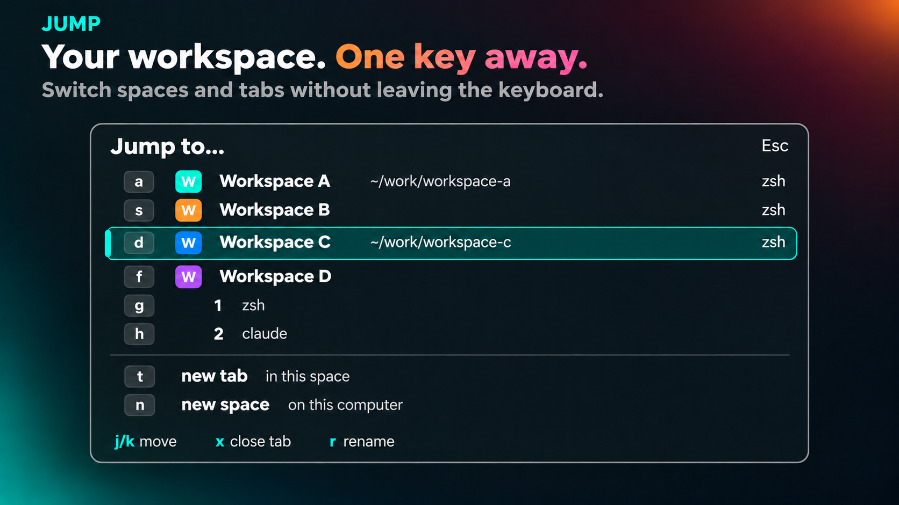
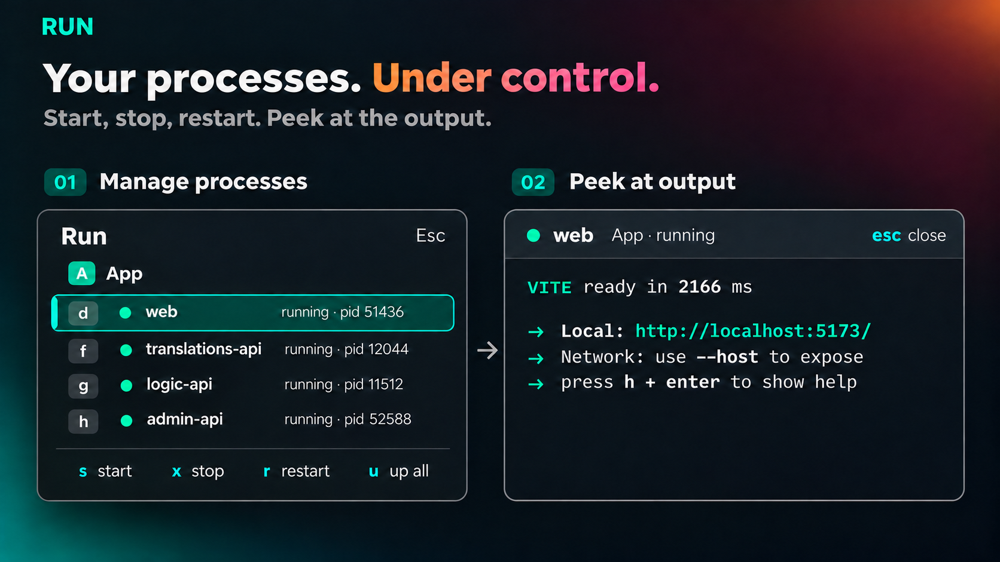
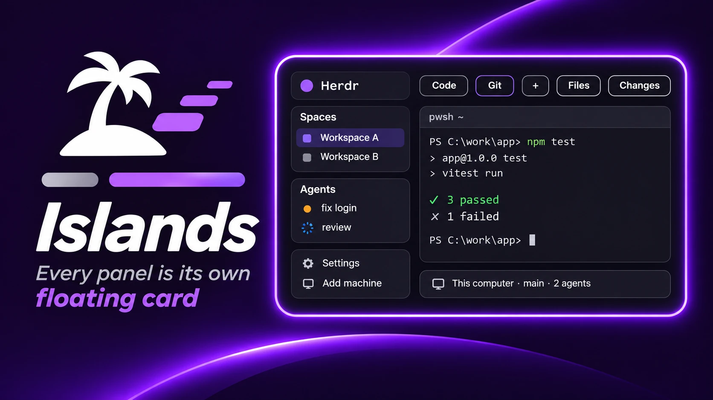
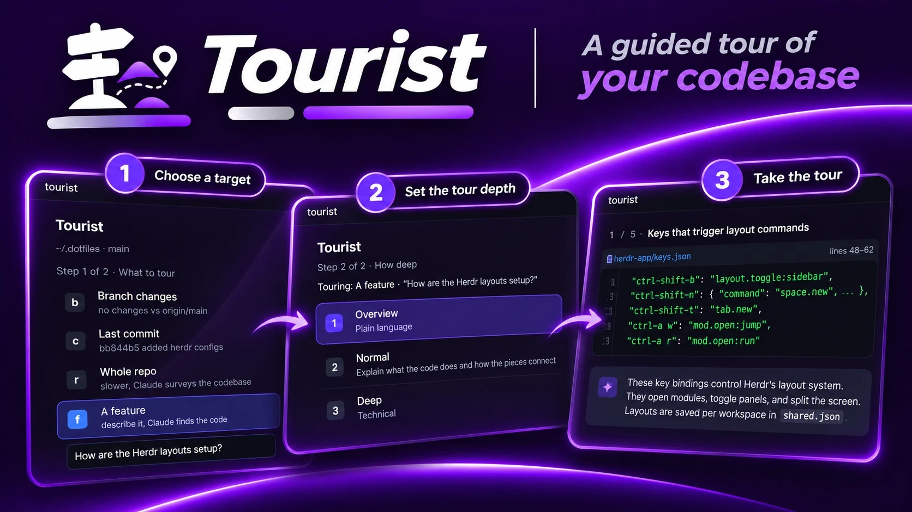
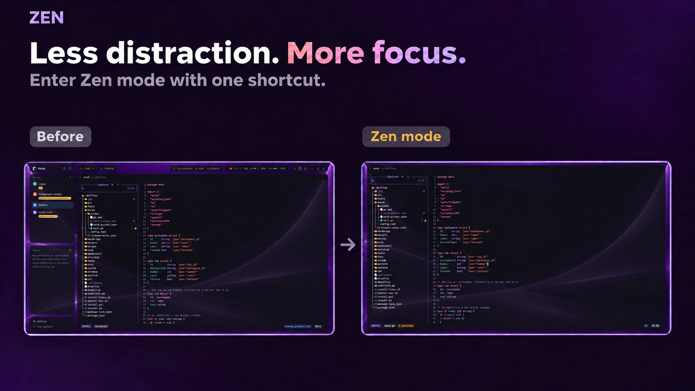
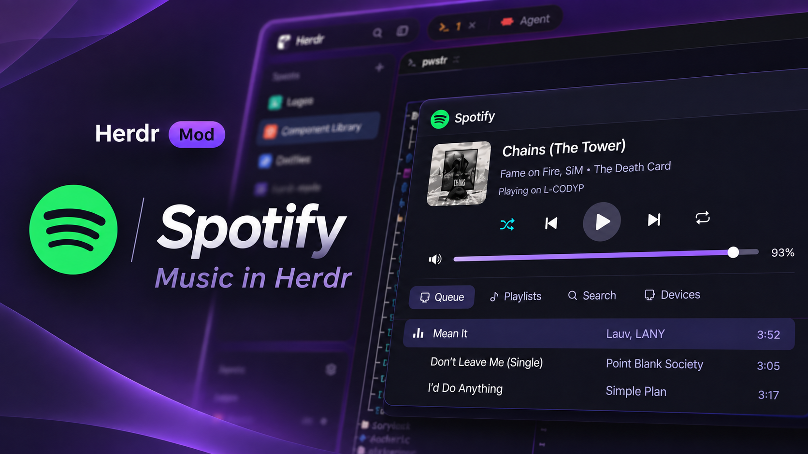

# herdr-mods

A few mods for the [Herdr](https://herdr.dev) desktop app. Grab the ones you want.

## jump

tmux's `prefix+w`, with vimium-style letters. Press `ctrl-shift-k`, type a letter, you're on that tab.



`j`/`k` move, `enter` goes, `x` closes the selected tab, `r` renames the selected tab or space, `t` new tab, `n` new space.
Want fixed letters for your spaces? Put them in `~/.config/herdr-app/hints.json`:

```json
{ "spaces": { "Logos": "l", "Component Library": "c" } }
```

## run

mprocs, but inside Herdr. Drop a `herdr.procs.json` in your repo:

```json
{
  "procs": [
    { "name": "web", "cmd": "npm run dev", "cwd": "apps/web" },
    { "name": "api", "cmd": "dotnet run --project services/api", "env": { "PORT": "5000" } }
  ]
}
```

Press `ctrl-shift-r`, hit `u`, everything starts in the background. Each row has a letter.



`s` start, `x` stop, `r` restart, `enter` to watch the output, `o` to turn it into a tab, `a` to see every space. Things that crash go red and you get a toast.

## islands

Herdr, but every panel is its own rounded card on the canvas. IntelliJ Islands, basically. Takes whatever theme you pick.



A layout plus six small mod clones that round off the shipped bars and lists and turn the tab bar controls into pills.

Don't want the branch pill under each space name? Add `"props": { "branch_pill": false }` next to `"mod": "islands-spaces"` in the layout.

Want all the tabs in one pill with dividers between them, instead of a pill each? Add `"props": { "joined": true }` next to `"mod": "islands-tabs"`.

Want a wallpaper behind the cards? Drop an image in `~/.config/herdr-app/backgrounds/` and change the layout root to `"background": { "image": "backgrounds/your.png", "fit": "cover" }`.

## tourist

Claude or Codex gives you a guided tour of your code. Press `ctrl-shift-g`, pick what to tour (branch changes, the last commit, an open pull request, the whole repo, or a feature you describe), pick a depth, and the agent walks you through it file by file. A pull request tour is a guided review: the stops are grouped by the problem or feature each change serves, most important first, and each one shows that file's diff. Click a diff line to leave a comment. On a peer's PR, `p` posts your comments to GitHub as one review (Comment, Approve or Request changes). On your own PR, `f` has the agent fix your comments in a separate worktree, and you review its diff before pushing it to the PR's branch or discarding it.



`n` next, `b` back, `d` deeper, `t` more technical, `a` ask, `o` open in VS Code, `s` switches between split and stacked (wide panes start split), `z` zooms the pane to full size and back, `q` ends the tour. `a` on the setup screen switches between Claude and Codex. Needs the `claude` or `codex` CLI signed in, and `gh` signed in for pull requests.

## zen

VS Code's zen mode for Herdr. Press `ctrl-shift-enter` (`cmd-shift-enter` on macOS) and everything but your panes goes away: sidebar, tab bar, status bars, side panels. Press it again and it all comes back. Works in any layout.



Anything you'd already hidden stays hidden when you leave zen. If your layout draws its own window buttons in the tab bar, those hide too until you press the key again.

## spotify

Spotify in Herdr. A now-playing slot for your bar, a hover card with the controls, and a dialog you drive from the keyboard. Press `ctrl-shift-m` (`cmd-shift-m` on macOS).



`h`/`l` switch between Queue, Playlists, Search and Devices, `j`/`k` move, `enter` plays. `space` play/pause, `n`/`b` next/previous, `[`/`]` seek, `-`/`=` volume, `z` shuffle, `r` repeat, `s` search, `a` adds to the queue.

It controls your Spotify, it plays nothing itself. Needs Spotify Premium, Spotify open on some device, and a free Spotify developer app of your own. The first open walks you through that.

For the slot, add a block to your layout (`"card": "above"` opens the hover card upward, for a bottom bar):

```json
{ "id": "spotify", "type": "block", "size": { "px": 220 }, "content": { "mod": "spotify", "props": { "slot": true } } }
```

Built and tested on Windows. The macOS sign-in helper has not been run yet: if it misses the login, the dialog asks you to paste the browser's address instead.

## Install

### Tell your agent

spotify:

```text
Read ~/.config/herdr-app/AGENTS.md, then add this mod:
https://github.com/CodeyPacker/herdr-mods/tree/main/spotify
```

jump:

```text
Read ~/.config/herdr-app/AGENTS.md, then add this mod:
https://github.com/CodeyPacker/herdr-mods/tree/main/jump
```

run:

```text
Read ~/.config/herdr-app/AGENTS.md, then add this mod:
https://github.com/CodeyPacker/herdr-mods/tree/main/run
```

tourist:

```text
Read ~/.config/herdr-app/AGENTS.md, then add this mod:
https://github.com/CodeyPacker/herdr-mods/tree/main/tourist
```

zen:

```text
Read ~/.config/herdr-app/AGENTS.md, then add this mod:
https://github.com/CodeyPacker/herdr-mods/tree/main/zen
```

islands:

```text
Read ~/.config/herdr-app/AGENTS.md, then add this layout:
https://github.com/CodeyPacker/herdr-mods/tree/main/islands
```

### By hand

Copy a mod's `mods/<name>` folder (or symlink it) into `~/.config/herdr-app/mods/` and check it loads:

```sh
herdr-app check ~/.config/herdr-app/mods/jump
```

Then add the key from that mod's `keys.json` to your `~/.config/herdr-app/keys.json`.
Each folder has a `RECIPE.md` with the full details, including what it runs on your machine.

For islands, copy `islands/layouts/*` into `~/.config/herdr-app/layouts/` and every folder from `islands/mods/` into `~/.config/herdr-app/mods/`. Then:

```sh
herdr-app do layout.switch '{"name":"islands"}'
```


Want a different accent on the active tab? That is the theme's accent, so `"colors": { "accent": "#20a68e" }` in `~/.config/herdr-app/settings.json` changes it on any theme.

## Hacking

Mods hot reload on save. `jump/mods/jump/tiles.js` and `run/mods/run/tiles.js` are the same file;
edit the one in `run/` and copy it over. Type-check with
`npx -p typescript tsc -p run/mods/run/jsconfig.json`.
