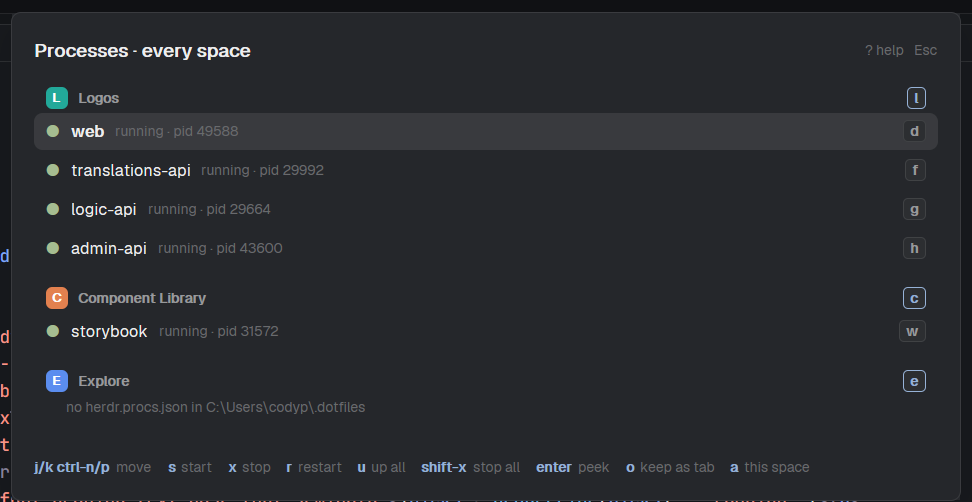
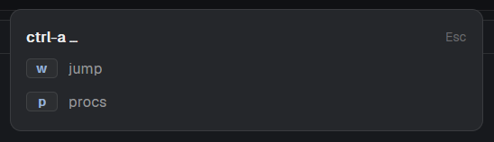

# herdr-mods

A few mods for the [Herdr](https://herdr.dev) desktop app. Grab the ones you want.

## jump

tmux's `prefix+w`, with vimium-style letters. Open it, type a letter, you're on that tab.


`j`/`k` move, `enter` goes, `x` closes the selected tab, `t` new tab, `n` new space.
Want fixed letters for your spaces? Put them in `~/.config/herdr-app/hints.json`:

```json
{ "spaces": { "Logos": "l", "Component Library": "c" } }
```

## procs

mprocs, but inside Herdr. Drop a `herdr.procs.json` in your repo:

```json
{
  "procs": [
    { "name": "web", "cmd": "npm run dev", "cwd": "apps/web" },
    { "name": "api", "cmd": "dotnet run --project services/api", "env": { "PORT": "5000" } }
  ]
}
```

Open the popup, hit `u`, everything starts in the background. Each row has a letter.



`s` start, `x` stop, `r` restart, `enter` to watch the output, `o` to turn it into a tab, `a` to see every space. Things that crash go red and you get a toast.

## leader

A tmux-style prefix key. Press `ctrl-a`, then one more key.



Mappings live in `~/.config/herdr-app/leader.json`. Copy `leader/leader.example.json` there to start:

```json
{ "w": "mod.open:jump", "p": "mod.open:procs", "c": "tab.new" }
```

Don't want the little box? `{ "show": false, "keys": { ... } }`.

## Install

Copy a mod folder (or symlink it) into `~/.config/herdr-app/mods/` and check it loads:

```sh
herdr-app check ~/.config/herdr-app/mods/jump
```

Then add the key from that mod's `keys.json` to your `~/.config/herdr-app/keys.json`.
Each folder has a `RECIPE.md` with the full details, including what it runs on your machine.

## Hacking

Mods hot reload on save. `jump/tiles.js` and `procs/tiles.js` are the same file;
edit the one in `procs/` and copy it over. Type-check with
`npx -p typescript tsc -p procs/jsconfig.json`.
