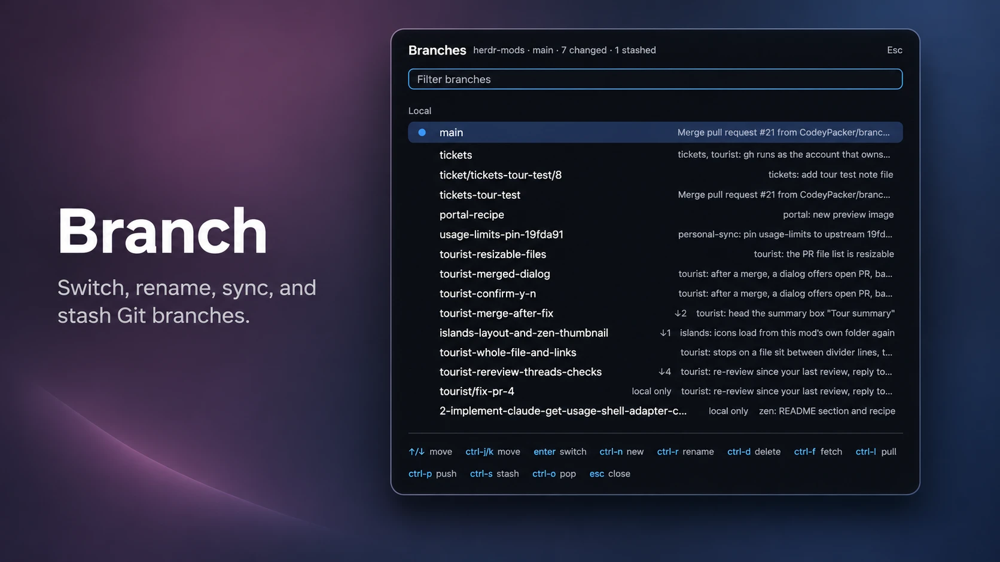
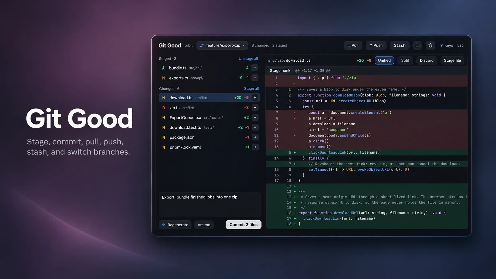
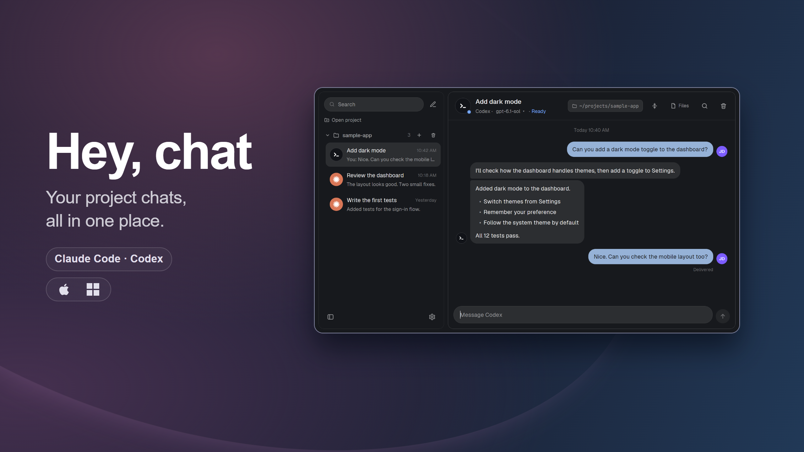
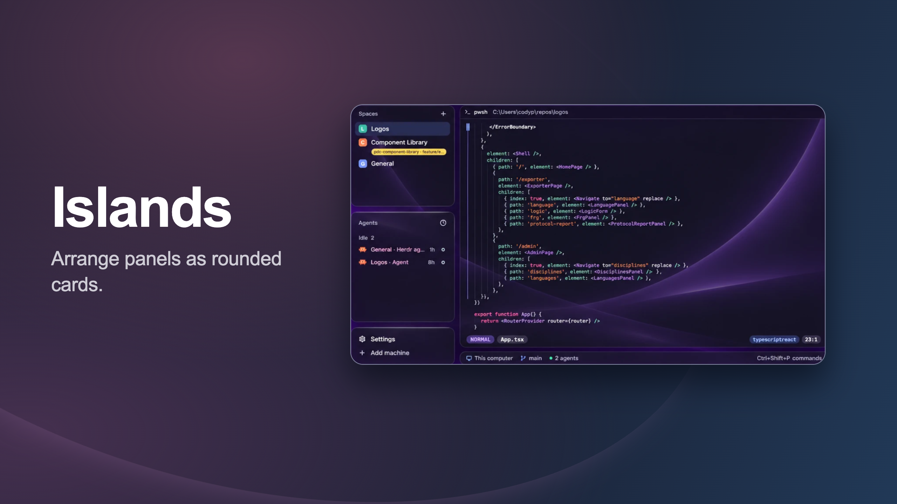

# herdr-mods

Mods for the [Herdr](https://herdr.dev) desktop app. Each folder is one mod, and its page says what it does, what it needs and how to install it.

## Mods

### [branch](branch/)

[](branch/)

Manage the current space's Git branches from one dialog: filter, switch, create, rename, delete, fetch, pull, push and stash.

```text
Read ~/.config/herdr-app/AGENTS.md, then add this mod: https://github.com/CodeyPacker/herdr-mods/tree/main/branch
```

---
### [Git Good](git-good/)

[](git-good/)

A dialog for everyday git work: the changed files with their diff beside them, staging by file or by hunk, commits with a message Claude can write, pull, push, stash and branches.

```text
Read ~/.config/herdr-app/AGENTS.md, then add this mod: https://github.com/CodeyPacker/herdr-mods/tree/main/git-good
```

---
### [Hey, chat](hey-chat/)

[](hey-chat/)

Chat with Claude Code or Codex in a Messenger-style pane, with your existing sessions grouped by folder, permission prompts you answer in the chat, and your own profile picture.

```text
Read ~/.config/herdr-app/AGENTS.md, then add this mod: https://github.com/CodeyPacker/herdr-mods/tree/main/hey-chat
```

---
### [islands](islands/)

[](islands/)

Herdr with every panel as its own rounded card on the canvas, in whatever theme you pick.

```text
Read ~/.config/herdr-app/AGENTS.md, then add this layout: https://github.com/CodeyPacker/herdr-mods/tree/main/islands
```

---
### [jump](jump/)

[](jump/)

tmux's `prefix+w` with vimium-style letters: press a key, type a letter, and you are on that tab.

```text
Read ~/.config/herdr-app/AGENTS.md, then add this mod: https://github.com/CodeyPacker/herdr-mods/tree/main/jump
```

---
### [keybinds](keybinds/)

A dialog that lists every key in your `keys.json`, grouped by what the keys act on, with a filter you type into.

```text
Read ~/.config/herdr-app/AGENTS.md, then add this mod: https://github.com/CodeyPacker/herdr-mods/tree/main/keybinds
```

---
### [Portal](portal/)

[](portal/)

Every local TCP listener and UDP socket, grouped by the process that owns it. Favorite ports, open them in the browser, and end the process holding one.

```text
Read ~/.config/herdr-app/AGENTS.md, then add this mod: https://github.com/CodeyPacker/herdr-mods/tree/main/portal
```

---
### [Practice Range](practice-range/)

C#, TypeScript and SQL repetition in its own tab: 800 short exercises per language, checked when you save, with Neovim or VS Code as your editor.

```text
Read ~/.config/herdr-app/AGENTS.md, then add this mod: https://github.com/CodeyPacker/herdr-mods/tree/main/practice-range
```

---
### [run](run/)

[](run/)

mprocs inside Herdr: list a repo's processes in `herdr.procs.json`, then start, stop, restart and watch them from one popup.

```text
Read ~/.config/herdr-app/AGENTS.md, then add this mod: https://github.com/CodeyPacker/herdr-mods/tree/main/run
```

---
### [spotify](spotify/)

[](spotify/)

Spotify in Herdr: a now-playing slot for your bar, a hover card with the controls, and a dialog you drive from the keyboard.

```text
Read ~/.config/herdr-app/AGENTS.md, then add this mod: https://github.com/CodeyPacker/herdr-mods/tree/main/spotify
```

---
### [tourist](tourist/)

[](tourist/)

Claude or Codex gives you a guided tour of your code: branch changes, the last commit, a pull request, the whole repo, or a feature you describe.

```text
Read ~/.config/herdr-app/AGENTS.md, then add this mod: https://github.com/CodeyPacker/herdr-mods/tree/main/tourist
```

---
### [tutor](tutor/)

Learn a language from a codebase you pick: the agent plans a course from its real code, with lessons, quizzes and practice exercises.

```text
Read ~/.config/herdr-app/AGENTS.md, then add this mod: https://github.com/CodeyPacker/herdr-mods/tree/main/tutor
```

---
### [Vim Docs](vim-docs/)

[](vim-docs/)

A small window of Vim commands to keep open while you work, with search and a starred list.

```text
Read ~/.config/herdr-app/AGENTS.md, then add this mod: https://github.com/CodeyPacker/herdr-mods/tree/main/vim-docs
```

---
### [zen](zen/)

[](zen/)

VS Code's zen mode for Herdr: one key hides everything but your panes, and the same key brings it all back.

```text
Read ~/.config/herdr-app/AGENTS.md, then add this mod: https://github.com/CodeyPacker/herdr-mods/tree/main/zen
```

---

## Install by hand

Copy a mod's `mods/<name>` folder (or symlink it) into `~/.config/herdr-app/mods/` and check it loads:

```sh
herdr-app check ~/.config/herdr-app/mods/jump
```

Then add the key from that mod's `keys.json` to your `~/.config/herdr-app/keys.json`.
Each folder has a `RECIPE.md` with the full details, including what it runs on your machine.

For islands, copy `islands/layouts/*` into `~/.config/herdr-app/layouts/` and every folder from `islands/mods/` into `~/.config/herdr-app/mods/`. Then:

```sh
herdr-app do layout.switch '{"name":"islands"}'
```


Want a different accent on the active tab? That is the theme's accent, so `"colors": { "accent": "#20a68e" }` in `~/.config/herdr-app/settings.json` changes it on any theme.

## Hacking

Mods hot reload on save. Type-check with `npx -p typescript tsc -p run/mods/run/jsconfig.json`.

The look and controls the mods share live in `kit/` at the repo root: the frame, list rows, letter
badges, tabs, chips, sliders, buttons, pane parts, the key legend. A mod can only import from its own folder, so
each mod that uses the kit carries a copy in `mods/<name>/kit/`. Edit `kit/`, never a copy, then:

```sh
node scripts/sync-kit.mjs          # copy kit/ into each mod
node scripts/sync-kit.mjs --check  # fail if a copy differs
```

To have every commit do this for you, turn on the repo's pre-commit hook once per clone:
`git config core.hooksPath .githooks`. It copies `kit/` into the mods and adds the copies to the commit.

`spotify`, `jump`, `run`, `portal` and `tourist` use the kit. To add a mod, list its folder in `scripts/sync-kit.mjs`.

## License

MIT, see [`LICENSE`](LICENSE).
