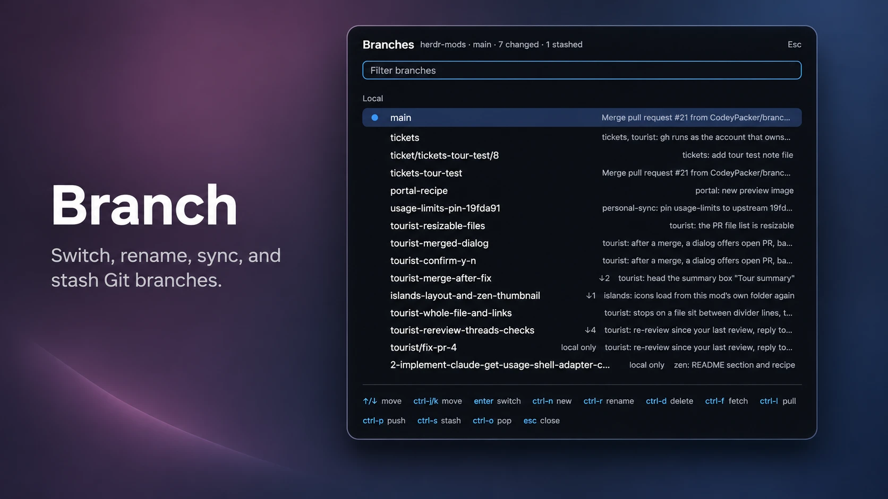

# branch

Manage the current space's Git branches from one dialog: filter, switch, create, rename, delete, fetch, pull, push and stash.



Manage the current space's Git branches. Press `ctrl-shift-y`, filter by name,
and press `enter` to switch. Local and remote branches show their latest commit
and ahead/behind counts.

`ctrl-n` new, `ctrl-r` rename, `ctrl-d` delete with confirmation, `ctrl-f`
fetch, `ctrl-l` pull (fast-forward only), `ctrl-p` push, `ctrl-s` stash,
`ctrl-o` pop the newest stash. Arrows or `ctrl-j`/`ctrl-k` move.

## Install

Tell your agent:

```text
Read ~/.config/herdr-app/AGENTS.md, then add this mod: https://github.com/CodeyPacker/herdr-mods/tree/main/branch
```

By hand: copy `mods/branch` (or symlink it) into `~/.config/herdr-app/mods/`, then add the key from [`keys.json`](keys.json) to your `~/.config/herdr-app/keys.json`.

[`RECIPE.md`](RECIPE.md) has the full details, including what it runs on your machine.
