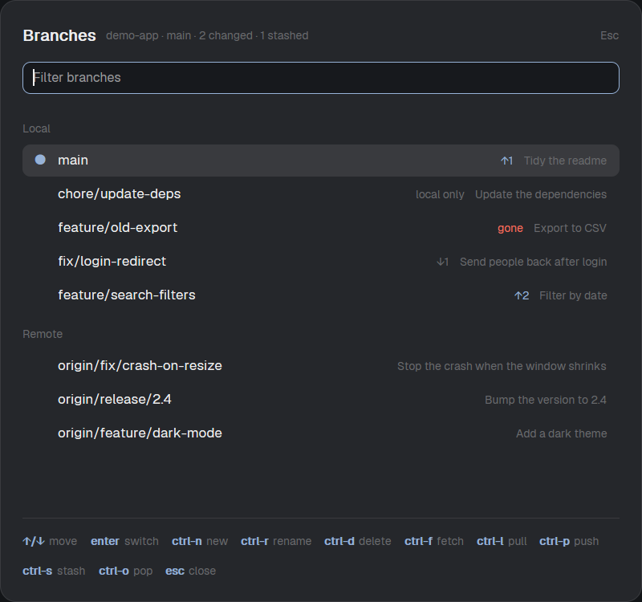

# Branch

A dialog that lists the local and remote git branches of the repo the current
space is in. A filter box narrows the list, and keys switch, create, rename,
delete, fetch, pull, push, stash and pop. The filter box always has the
keyboard, so plain letters filter and every action is a ctrl key.

## What you see

A dialog 640 px wide and 70% of the window high, in the shared kit's frame.
Top line: "Branches", then in small dim text the repo's folder name, the
current branch, "N changed" and "N stashed" (each only when not zero), joined
with " · ". With no branch checked out the branch part reads "detached at
<short sha>". A spinner sits after that text while git runs. "Esc" is at the
right.

Under it, the filter box with the placeholder "Filter branches".

Then the list, which scrolls. A "Local" label, the local rows, a "Remote"
label, the remote rows. A label shows only when its section has rows. Each row,
left to right:

- a 14 px column with a dot in the accent color on the current branch
- the branch name, such as `feature/x` or `origin/feature/x`
- small marks, on local branches only: `↑2` (accent) for commits to push, `↓1`
  (dim) for commits to pull, "gone" (blocked color) when the upstream was
  deleted, "local only" (dim) when it has no upstream
- the last commit's first line in small dim text, cut at 260 px

The selected row has the kit's selected background.

Between the filter box and the list, only when open: the name box ("New branch
from X" or "Rename X" with an input), or the delete question.

Under the list, one small line when there is something to say: git's error or a
refusal in the blocked color, or news such as "Pushed main to origin" in dim.

Bottom, after a thin line, the key legend: `↑/↓` move, `enter` switch, `ctrl-n`
new, `ctrl-r` rename, `ctrl-d` delete, `ctrl-f` fetch, `ctrl-l` pull, `ctrl-p`
push, `ctrl-s` stash, `ctrl-o` pop, `esc` close.

## How it behaves

- Which repo: the folder of the focused pane in the active space's shown tab.
  If that pane has no folder, any pane in that tab, then any pane in the space,
  then the folder the space was made in. Git runs on the space's machine, so a
  remote space works. A `folder` prop skips all that and uses that folder on
  this computer.
- The list: local branches first, then remote ones. In each group the current
  branch is first, then the newest commit first. A remote branch that a local
  branch tracks has no row of its own. `origin/HEAD` has no row.
- The filter keeps branches whose name holds every word typed, ignoring case.
  Typing selects the first row.
- `up`/`down` or `ctrl-k`/`ctrl-j` move the selection and wrap at the ends. A
  click selects a row.
- `enter` switches to the selected branch. On a remote row it switches to the
  local branch of the same short name (`origin/feature/x` gives `feature/x`)
  and makes that branch, tracking the remote one, when it does not exist yet.
  After a switch the dialog closes and a notification says "Switched to X".
- `ctrl-n` opens the name box for a new branch that starts at the selected
  branch (at `HEAD` when no row is selected). The box starts with the filter's
  text. `enter` creates the branch and switches to it. A name git refuses keeps
  the box open with git's message under the list.
- `ctrl-r` opens the name box with the old name selected. `enter` renames.
- `ctrl-d` asks "Delete branch X?". `enter` deletes. When git says the branch
  is not fully merged, it asks once more, and `enter` then deletes it anyway.
- `ctrl-r` and `ctrl-d` on a remote row do nothing but say "Remote branches
  cannot be renamed or deleted here".
- `ctrl-f` fetches every remote and drops remote branches that are gone there.
- `ctrl-l` pulls the current branch, whatever row is selected, fast-forward
  only. With no upstream it says so and runs nothing.
- `ctrl-p` pushes the selected local branch, current or not. With an upstream
  it goes to that remote branch. Without one it goes to a branch of the same
  name on `origin` (else the repo's first remote), which becomes its upstream.
  On a remote row it says "Select a local branch to push".
- `ctrl-s` stashes every uncommitted change, untracked files too, and says
  "Stashed N changes". With a clean tree it says "Nothing to stash".
- `ctrl-o` pops the newest stash. With none it says "No stash to pop". On a
  conflict or a refusal git keeps the stash and its message is shown.
- `esc` closes the name box or the question when one is open. Else it clears
  the filter when it has text. Else it closes the dialog.
- After fetch, pull, push, stash, pop, rename and delete the list is read
  again and the dialog stays open.
- While git runs, keys do nothing. While the name box or a question is open,
  only `enter` and `esc` work.
- Any other key clears the line under the list.

## Built from

- `mods/branch/main.js` (the view), `git.js` (every git call), `parse.js`
  (parse, sort and filter the branch list), and `mods/branch/kit/`, this repo's
  shared kit: the frame, list rows, section labels, the text input, the
  spinner, the key legend.
- `mod.json`: `{ "place": "none", "title": "Branch", "overlay": { "kind": "dialog", "width": 640, "height": 0.7, "frame": "none" } }`.
- `keys.json` opens it: `"ctrl-shift-y": "mod.open:branch"`.
- Git runs through `exec("git", args, { cwd, on })` from `herdr`, with the
  arguments as an array, never as a shell string. `on` is the space's machine.
- Finding the repo: `git rev-parse --show-toplevel` in the folder.
- The list: `git --no-optional-locks for-each-ref --format=<format> refs/heads
  refs/remotes`. The format asks for the ref name, the `HEAD` mark, the short
  upstream, the upstream track text, the commit time, the worktree path and the
  subject, split by the unit separator `%1f`. With no current branch,
  `git rev-parse --short HEAD` gives the sha for "detached at".
- The counts: `git --no-optional-locks -c core.fsmonitor=false status
  --porcelain` (lines are changed and untracked files) and `git stash list`
  (lines are stash entries).
- Switch: `git switch <name>`. From a remote row with no local branch:
  `git switch --track <remote>/<name>`.
- New: `git switch -c <name> <from>`. Rename: `git branch -m <old> <new>`.
  Delete: `git branch -d <name>`, and `git branch -D <name>` after the second
  yes.
- Fetch: `git fetch --all --prune`. Pull: `git pull --ff-only`.
- Push: `git remote` lists the remotes first. With an upstream:
  `git push <remote> refs/heads/<name>:refs/heads/<upstream branch>`. Without:
  `git push -u <remote> refs/heads/<name>`.
- Stash: `git stash push --include-untracked`. Pop: `git stash pop`.
- Fetch, pull and push may take 120 seconds each before they give up.
- Every key is also a command, read with `nextCommand()`:
  `herdr-app do branch.<command>` with `up`, `down`, `switch`, `new`, `rename`,
  `delete`, `fetch`, `pull`, `push`, `stash`, `pop`, `cancel` (what `esc`
  does), `yes` (what `enter` does in the name box or a question) and `focus`
  (puts the keyboard back on the filter box).
- Props: `folder` (the repo to show, on this computer) and `filter` (the
  filter's starting text). As a layout block, `{ "mod": "branch", "props": {
  "folder": "..." } }`, there is no dialog to close, so a switch reloads the
  list.
- `notify({ title })` for "Switched to X".
- Theme colors only, through the kit's `colors()`: `foreground`, `dim`,
  `accent`, `blocked`.

## Watch out

- Pull is `--ff-only`. A pull that would need a merge fails with git's message
  and changes nothing.
- It never force pushes. Both sides of a push are full ref names
  (`refs/heads/...`), so git reads no part of a branch name as an option or a
  force mark.
- It never stashes by itself. A switch with uncommitted changes is left to
  git, which carries them over or refuses with its own message.
- Remote branches cannot be renamed or deleted. The mod runs no command that
  changes a branch on a remote other than push.
- The second yes on a delete is `git branch -D`. Commits only that branch had
  are then reachable only through the reflog.
- Stash and pop read the counts again right before they run, since files can
  change while the dialog is open.
- `enter` is not in the key handler. It arrives as the input's "submit", from
  the filter box or the name box.
- The filter box is focused again 600 ms after the dialog opens, once the app
  has put the keyboard on the dialog.
- Make the `ScrollHandle` in `init`, not in `render`.
- Elements are single-use: each row is built once per render.
- The row to scroll to counts the "Local" and "Remote" labels before it.
- Type-clean under the jsconfig the app writes (`checkJs`, `strict`). Check
  with `npx -p typescript tsc -p jsconfig.json`.

## Done when

- `herdr-app check ~/.config/herdr-app/mods/branch` passes.
- In a space on a repo, `ctrl-shift-y` opens the dialog. The top line shows the
  repo's name and the current branch, and the current branch's row has the dot.
- In a space on a folder that is no repo, it says "Not a git repository" and
  the folder.
- Typing part of a name narrows the list. `esc` clears the filter, and `esc`
  again closes the dialog.
- `enter` on another local branch closes the dialog, and `git branch
  --show-current` in the repo prints that branch.
- `enter` on a remote row with no local branch makes one, and `git status -sb`
  shows it tracks the remote branch.
- `ctrl-n`, a name, `enter` makes a branch at the selected one and switches to
  it.
- `ctrl-r` renames a local branch. `ctrl-d`, then `enter`, deletes one. An
  unmerged branch asks a second time.
- `ctrl-r` and `ctrl-d` on a remote row only show the refusal.
- `ctrl-f` after someone else pushed shows `↓N` on that branch. `ctrl-l` on it
  as the current branch clears the mark and says "Pulled X".
- `ctrl-p` on a "local only" branch pushes it to `origin`. The mark goes away
  and it says "Pushed X to origin".
- With an edited file, the top line says "1 changed". `ctrl-s` turns that into
  "1 stashed" and `git status --porcelain` prints nothing. `ctrl-o` brings the
  change back.
- `herdr-app do branch.down` with the dialog open moves the selection.
