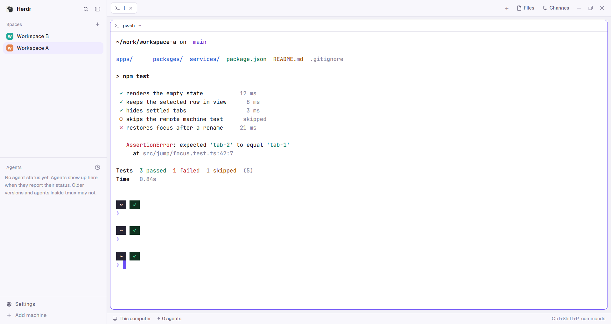

# Cupertino

Apple-ish colors for Herdr: lavender-grey canvas, white panels, hairline
borders, purple accent, one palette for light and one for dark, following
your system appearance. It's two theme files plus a layout that is Herdr's
stock window with those themes preselected. Pair it with
[islands](../islands) for rounded cards: pick `cupertino-light` and
`cupertino-dark` on that layout and you have both.



## What you see

Herdr's default window, unchanged in shape: a 268 px sidebar with the brand
row, Spaces, Agents and a footer; a 42 px tab bar; the focused tab's panes
as cards with 10 px corners and the `pane` header; Files and Changes on the
right when open; a 28 px status bar. Only the colors change.

Colors, light / dark:

| name | light | dark |
|---|---|---|
| canvas | `#f2f1f7` | `#0e0d14` |
| chrome (sidebar, bars) | `#f8f7fc` | `#1c1a27` |
| background, surface (terminals, cards) | `#ffffff` | `#1b1a24` |
| raised, popover | `#ffffff` | `#262433` |
| hover | `#efedf6` | `#2a2837` |
| selected | `#f0ecff` | `#29234a` |
| border | `#e2e0eb` | `#212027` |
| input | `#f5f4f9` | `#14131b` |
| foreground | `#16141f` | `#f4f3f9` |
| muted | `#5c5970` | `#aba8bd` |
| dim | `#86839a` | `#7a778d` |
| accent | `#6b4ef6` | `#6b4ef6` |
| accent_foreground | `#ffffff` | `#ffffff` |
| solid / solid_foreground | `#16141f` / `#ffffff` | `#f4f3f9` / `#16141f` |
| ring | `#6b4ef6` | `#9c88ff` |
| selection (terminal) | `#eeeaff` | `#2b2452` |
| cursor | `#6b4ef6` | `#6b4ef6` |
| working | `#3b82f6` | `#5b93f7` |
| blocked | `#f5a524` | `#e8a33a` |
| done | `#18b47a` | `#2fc488` |
| idle, unknown | `#86839a` | `#7a778d` |

Terminal ANSI, light 0-15: `#16141f #c2252c #0a7a51 #a35406 #1f5fd6 #5235d6
#0e7c66 #5c5970 #86839a #ee4447 #18b47a #f5a524 #3b82f6 #6b4ef6 #20a68e
#16141f`. Dark: `#262433 #ff7b7f #45d69a #f8c15a #86afff #b5a6ff #5fd3b0
#aba8bd #7a778d #f0565b #2fc488 #e8a33a #5b93f7 #c4a7ff #20a68e #f4f3f9`.

The values come from PReview's `tokens.css` (the same tokens Pensieve uses):
`canvas`, `surface-solid`, `surface-raised`, `surface-hover`,
`surface-selected`, `surface-sunken`, `ink`, `ink-secondary`, `ink-tertiary`,
`accent`, `accent-soft`, `focus-ring`, and the info/warning/success fills.
The translucent ones (`surface`, `border`) are flattened onto the canvas,
because Herdr theme files take `#rrggbb` only. The ANSI 16 are built from
PReview's semantic and syntax colors; it has no terminal palette of its own.

## How it behaves

- The layout's `theme` is `{ "light": "cupertino-light", "dark": "cupertino-dark" }`,
  so it follows the system appearance. `"appearance": "light"` or `"dark"`
  in settings.json pins one.
- Agent status colors: `working` blue, `blocked` orange, `done` green, idle
  grey, wherever the shipped mods draw them.
- On any other layout, pick the themes in Settings > Look or with
  `herdr-app do app.theme '{"name":"cupertino-light"}'` and again with
  `cupertino-dark` (each call sets the half that matches the theme's own
  lightness). The pick sticks to that layout.

## Built from

- `themes/cupertino-light.json`, `themes/cupertino-dark.json`: Herdr theme
  files, `background`, `foreground`, `selection`, `cursor`, `ansi[16]` and a
  `colors` block that names every panel color from the table above.
- `layouts/cupertino.json`: Herdr's shipped `main.json` (0.1.13) as-is,
  plus two root fields:

```json
"theme": { "light": "cupertino-light", "dark": "cupertino-dark" },
"preview": "layouts/cupertino.svg"
```

- `layouts/cupertino.svg`: the 160x100 picture the settings screen shows.

No mods. Nothing runs on the machine beyond what Herdr's own layout does.

## Watch out

- Both theme files have to be in `~/.config/herdr-app/themes/`. AGENTS.md's
  install steps only mention `layouts/` and `mods/`, so say it. With a theme
  missing, `layout.switch` answers ok and the window shows, but in Herdr's
  default graphite or paper colors: `layout.error` and `herdr-app status` say
  `layouts/cupertino.json was not applied: theme "cupertino-light" is not one
  of graphite, ink, moss, paper and there is no themes/cupertino-light.json`.
  Copying the themes in afterwards doesn't clear it by itself: run
  `layout.switch` again.
- `app.theme {name}` only sets the half (light or dark) that matches the
  theme's own lightness. To see the other half set `"appearance"` in
  settings.json. Theme picks are saved as clicks in `layouts/.state/` and
  beat the layout file.
- Light mode shows terminal programs that assume a dark background (an
  editor with a dark colorscheme) on white. That's the program, not the
  theme: the 16 ANSI colors and `foreground` are picked for white.
- Fonts are left unset on purpose. Setting `ui_font` to a font the other OS
  lacks just falls back, so there's nothing to gain.
- Herdr replaces its shipped `main.json` on every update. This layout is a
  copy of the 0.1.13 one and won't pick up later changes to the stock window.
  If that matters, drop the layout and just pick the themes on `main`.

## Done when

- `~/.config/herdr-app/themes/cupertino-light.json`, `themes/cupertino-dark.json`,
  `layouts/cupertino.json` and `layouts/cupertino.svg` are in place and
  `herdr-app status` lists no errors after
  `herdr-app do layout.switch '{"name":"cupertino"}'`.
- `herdr-app shot` in light mode shows a `#f8f7fc` sidebar on a `#f2f1f7`
  canvas, white panes, `#6b4ef6` on the focused pane's border, and
  `#16141f` text. Setting `"appearance": "dark"` flips to `#1c1a27` /
  `#0e0d14` / `#1b1a24` within a second.
- `herdr-app do app.theme '{"name":"cupertino-dark"}'` on the `islands`
  layout recolors its cards the same way.
- Settings > Look lists Cupertino with the picture from `cupertino.svg`.
