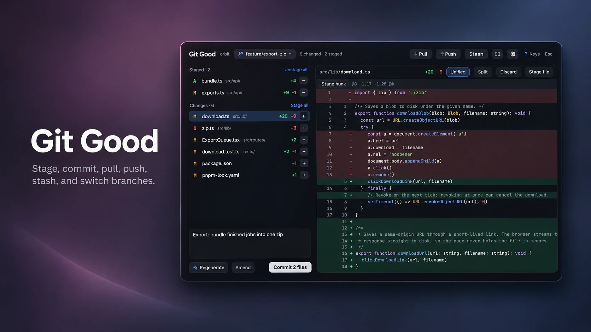

# Git Good

A dialog for everyday git work on the repo the current space is in. The
changed files sit in two lists, staged and not staged, with the selected
file's diff beside them and a commit box under them. Stage by file or by
hunk, commit with a message Claude can write, pull, push, stash and switch
branches. Runs Git on the space's machine.

## What you see

A dialog 1040 px wide and 85% of the window tall, centered, in the shared
kit's frame: theme `popover` background, rounded corners, a 1 px `border`,
22 px padding and 14 px gaps. `f` makes it fill the window.

**Title row.** "Git Good" in semibold, the repo's folder name in 11 px dim
text, a bordered branch button (branch icon in the accent color, the
current branch, a `▾`), then dim counts such as "8 changed · 2 staged ·
1 stashed". On the right: a spinner while Git runs, bordered buttons
"↓ Pull" and "↑ Push" (with the count behind or ahead when there is one),
"Tour" (only when the Tourist mod is installed), a full screen icon, a
gear icon, a `? keys` hint while the key list is hidden, and "Esc".

**Left column**, 330 px wide (380 px in full screen):

- "Staged · N" with an "Unstage all" link, then "Changes · N" with a
  "Stage all" link. The headings are 11 px dim text and the links use the
  accent color.
- One row per file: a status letter (`M`, `A`, `D`, `U` for a file Git
  does not know yet, `!` for a conflict), the file name, its folder in dim
  text, lines added in green and removed in red, and a small bordered `+`
  or `−` button. The selected row has the theme's `selected` background.
- Within each list, tests, `package.json`, generated files and lock files
  sort below everything else, in that order.
- In full screen only: a 230 px tall list of the 30 newest commits. The
  ones not pushed yet sit under "Not pushed · N", and the rest under "On
  <upstream>", or "Recent commits" when the branch has no upstream.
- The commit box: a 96 px text area with the placeholder "Commit message",
  then a "Generate" button with a sparkle icon ("Regenerate" once there is
  text, "Stop" with a spinner while Claude writes), an "Amend" chip, and a
  filled "Commit N files" button that is dim until there is a message and
  something staged.

**Right pane**, with a 1 px border that turns a dim accent color while the
keyboard is on it:

- A 40 px header: the file's folder in dim mono text and its name in the
  foreground color, the lines added and removed, chips "Unified" and
  "Split", and buttons "Discard" and "Stage file" or "Unstage file".
- The diff in the mono font at 12 px. Each hunk starts with a 28 px
  heading on the `raised` background that holds a "Stage hunk" or "Unstage
  hunk" button and Git's `@@` line. Lines are 20 px tall with old and new
  line numbers, a `+` or `−` mark, and syntax colors (keyword, string,
  comment, number, function call, type). Added lines have a faint green
  wash and removed lines a faint red one.
- Split view puts the old file on the left and the new one on the right.
  A diff that only adds or only removes is drawn in one column anyway.

Under the panes, one line shows a question ("Discard the changes to
<file>? This cannot be undone. enter does it, esc cancels") or the result
of the last action. With key hints on, a
divider and a wrapping key list close the dialog.

Two panels open over the dialog: the branches (a filter box, then Local
and Remote rows with a dot on the current branch and marks such as `↑2`,
`↓1`, `gone`, `local only`), and the settings.

## How it behaves

- `ctrl-a g` opens it. It finds the repo from the active space's focused
  pane, then reads the status, branches and log together.
- The keyboard is on the file list or on the diff. `ctrl-h` puts it on the
  list and `ctrl-l` on the diff. `j`/`k` or the arrows move the selection
  in the list (wrapping), or scroll the diff three lines.
- `space` or `enter` stages or unstages the selected file. The row moves
  to the other list at once and Git runs behind it. Presses queue, and the
  selection lands on the next unstaged file, so `space` can be held down a
  list. `a` stages everything and `u` unstages everything.
- A click on a hunk's heading stages that hunk alone, or takes it back out
  when the row is staged. Files Git does not know yet, and files in
  conflict, are staged whole.
- `d` asks before discarding a file's unstaged changes. `y` or `enter`
  goes ahead, `n` or `esc` cancels. A staged row must be unstaged first.
- `c` puts the keyboard in the commit box. `enter` there is a new line,
  `ctrl-enter` commits, `esc` goes back to the list. `g` has Claude write
  the message from the staged changes, and `m` switches amend on, which
  also loads the last commit's message into an empty box.
- `l` pulls, fast-forward only. `p` pushes the current branch, never
  forced, and sets the upstream when there is none. `s` stashes every
  change, untracked files too, and `o` pops the newest stash.
- `b` opens the branches. Typing filters, the arrows or `ctrl-j`/`ctrl-k`
  move, `enter` switches (a remote row makes a tracking local branch when
  none exists), `ctrl-enter` makes a new branch from HEAD with the typed
  name, `esc` goes back.
- `v` switches between unified and split. `f` switches between the dialog
  size and the whole window, without reading anything again. `r` reads
  everything again. `?` shows or hides the key list.
- `t`, with Tourist installed, closes the dialog and opens Tourist in a
  pane beside the focused one, set to tour everything on the branch.
- The gear or `,` opens the settings: "Show key hints", "Open in full
  screen", and a row per shortcut. `space` switches a shortcut off or on,
  `enter` or a click on its key waits for a new key, `esc` or a click
  beside the panel closes it. Without Tourist, a line there says where to
  get it.
- `esc` closes the open question, panel or commit box first, then the
  dialog. A click beside the dialog closes it.

## Built from

- `mods/git-good/main.js` draws the view and handles keys. `git.js` runs
  Git. `parse.js` reads Git's output (status, diff, branches, log) and
  sorts the files. `syntax.js` colors code a line at a time. `ai.js` asks
  Claude for a commit message. `tourist.js` is the optional link to
  Tourist. `kit/` holds the shared UI parts, with the settings panel in
  `kit/shortcuts.js`.
- `mod.json`: `place: "none"`, title "Git Good", and a dialog overlay with
  width 1, height 1 and `frame: "none"`. The overlay always covers the
  window and the mod draws its own 1040 px by 85% frame inside it, so full
  screen is only a bigger box. `keys.json` maps `ctrl-a g` to
  `mod.open:git-good`.
- Props: `folder` picks a repo, `full` opens filling the window, `split`
  opens in two columns, `message` fills the commit box, `select` picks a
  row.
- Uses `spaces`, `panes`, `props`, `exec`, `closeOverlay`, `nextCommand`,
  `settings`, `appHome`, `readTextFile`, `writeTextFile`, `run` and
  `window` from `herdr`, a virtual list for the diff, and native
  InputState, TextareaState and ScrollHandle. Every key is also a command:
  `herdr-app do git-good.<command>`.
- Git commands: `rev-parse`, `status --porcelain=v1 -z`, `diff` (also
  `--cached` and `--numstat`), `for-each-ref`, `log`, `stash list`,
  `add -A`, `reset -q`, `restore --worktree`, `clean -f`,
  `apply --cached` (and `--reverse`), `commit` (and `--amend`),
  `pull --ff-only`, `push`, `remote`, `switch` (and `-c`, `--track`),
  `stash push --include-untracked` and `stash pop`. Arguments are separate
  array items, never a shell string, and file paths are passed as literal
  paths. Pull, push and commit allow 120 seconds.
- Staging one hunk writes a one-hunk patch file under the app's
  `data/git-good/` folder, applies it and deletes it.
- The commit message comes from the `claude` CLI: `claude -p <prompt>`
  with only `git diff` and `git log` allowed, run in the repo, with a
  180 second limit.
- Settings are saved in the mod's own storage.
- `preview.png` is the promotional image. `thumbnail.png` holds the same
  artwork.

## Watch out

- Requires Git on the space's machine. It changes the index, the working
  files and branches. Discard deletes work and cannot be undone. Pull and
  push contact the repo's remotes with its existing sign-in.
- Generating a message needs the `claude` CLI signed in, and sends the
  staged diff to it. Everything else works without it.
- Staging by hunk works only for a repo on this computer.
- The app closes a dialog on esc whatever the mod's key handler does. The
  mod binds esc to its own action in a key context around its text boxes
  and while a question or panel is open. Without that, esc there closes
  the whole dialog.
- Handlers such as `on_click` inside the virtual list's row renderer throw
  and the list draws nothing. Clicks on hunk headings come through the
  list's `on_item_click`.
- The diff's scroll handle can only bring a row into view, so `j`/`k`
  scrolling asks for a row half a pane below the wanted top and centers
  it. The very top is asked for by its own row.
- Each Git call costs a few hundred milliseconds on Windows. Calls that do
  not depend on each other run together, and a file's diff is shown from
  memory while it is read again.
- Syntax colors come from a line-by-line reader, not a parser. A comment
  or string that starts above a hunk is not seen until it closes.
- No merge, rebase, conflict resolution, or history beyond the 30 newest
  commits.
- Edit the shared parts in the repo's root `kit/`, then run
  `node scripts/sync-kit.mjs`.

## Done when

- `herdr-app check git-good/mods/git-good` passes.
- Opening inside a repo shows the two lists, the counts and the selected
  file's diff. Opening outside one says so.
- `space` moves a file between the lists at once and `git status` agrees
  afterward. Staging one hunk leaves the file in both lists.
- Discard asks first. A commit with a message clears the box and the
  staged list. Amend replaces the last commit.
- Pull, push, stash and pop report Git's result on the line under the
  panes and refresh the lists.
- `f` changes the size without the lists emptying. `v` changes the diff
  view. `esc` in the branches or the settings closes only that panel.
- Test anything that changes a repo in a disposable one.
