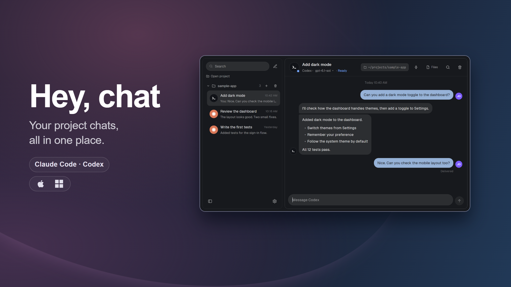

# Hey, chat

Chat with Codex or Claude Code in a Herdr tab. Each project has its own conversations, model picker, permission prompts and message queue.



## Set up from scratch

1. **Install Herdr.** Get it from [herdr.dev](https://herdr.dev), open it once, then quit it.
2. **Install Node.js.** Use the **LTS installer** from [nodejs.org](https://nodejs.org/en/download), with the default options. If Node.js 22 or newer is already installed, skip this step.
3. **Download this mod.** [Download the repository ZIP](https://github.com/CodeyPacker/herdr-mods/archive/refs/heads/main.zip) and extract it. Open the extracted `herdr-mods-main` folder in Terminal on macOS or PowerShell on Windows. On Windows, right-click inside the folder and choose **Open in Terminal**. On macOS, open Terminal, type `cd `, drag the folder into the window, and press Enter.
4. **Run the installer:**

   ```text
   node hey-chat/install.mjs
   ```

5. **Open Herdr.** Press **Ctrl+Shift+H**. Hey, chat checks this computer and walks you through any remaining setup. Already installed and signed in? Start chatting.

The installer copies only Hey, chat and adds its shortcut. It preserves other key bindings, backs up an existing installation, and stops if the shortcut is already assigned to something else. Set `HERDR_APP_HOME` before running it if you use a custom Herdr home. No Git, npm packages for the mod, or manual JSON editing are needed.

## Choose your agent

You only need **one** agent. The setup screen has copy buttons for the commands below and a **Check again** button. It never installs software or sends an agent message automatically. You need an account with access to your chosen agent. Its normal usage limits and billing apply.

### Codex

With Node.js installed, run this in Terminal:

```text
npm install -g @openai/codex
codex login
```

On Windows, use this in PowerShell:

```powershell
npm.cmd install -g @openai/codex
codex login
```

Finish signing in in your browser. See the [official Codex install guide](https://learn.chatgpt.com/docs/codex/cli) and [authentication guide](https://learn.chatgpt.com/docs/auth?surface=cli).

### Claude Code

macOS Terminal:

```sh
curl -fsSL https://claude.ai/install.sh | bash
claude auth login
```

Windows PowerShell:

```powershell
irm https://claude.ai/install.ps1 | iex
claude auth login
```

Finish signing in in your browser. See the [official Claude Code install guide](https://code.claude.com/docs/en/setup) and [authentication guide](https://code.claude.com/docs/en/authentication).

After installing tools, quit and reopen Herdr so it can find them. Open **Settings → Agent setup** to check again at any time. An older agent that cannot report sign-in status offers **Continue** after you have signed in yourself.

On Windows, install Node.js and your agent in Windows itself, using PowerShell. A tool installed only inside WSL is not available to a native Windows Hey, chat tab.

## Start a conversation

Open a terminal in your project, then press **Ctrl+Shift+H**. The project’s chat tab opens or comes forward. **New chat** stays in that project. **Open project** chooses another folder and opens its tab. Existing sessions for that folder appear automatically, and reopening restores your last conversation.

Choose Codex or Claude Code, type your message and send. Click the model beside the agent name to change it. Messages sent while an agent works are queued. **Send now** steers the current turn. Closing a tab leaves its agent running.

Tool cards are hidden by default. Useful activity appears beside the typing dots while work runs. Your profile settings control this and your photo or initials.

## If something is missing

- **Node.js or agent not found:** quit and reopen Herdr after installation. Check **Settings → Agent setup**. Custom installations must be on Herdr’s `PATH`. Native agents in `~/.local/bin` are also detected.
- **Sign-in needed:** run the displayed login command in Terminal or PowerShell, complete the browser flow, then click **Check again**. Credentials stay with the agent. Do not paste them into a chat.
- **Shortcut does nothing:** confirm the installer completed and restart Herdr. The installer reports conflicts instead of replacing an existing shortcut, and keeps a key you already set for Hey, chat.
- **Installer says the mod is linked:** this is a development installation. Update the linked source rather than installing over it.

## Keys

| Key | Action |
| --- | --- |
| Ctrl+Shift+H | Open project chat or return to the previous tab |
| Ctrl+B | Show or hide sidebar |
| Ctrl+H / Ctrl+L | Focus sidebar / composer |
| Ctrl+J / Ctrl+K | Scroll conversation |
| Ctrl+C | Stop the current turn |

Deleting a conversation also deletes its agent session permanently, after confirmation. It never deletes project files.

For an agent-assisted installation, ask it to read your Herdr home’s `AGENTS.md` and install [this mod](https://github.com/CodeyPacker/herdr-mods/tree/main/hey-chat).
