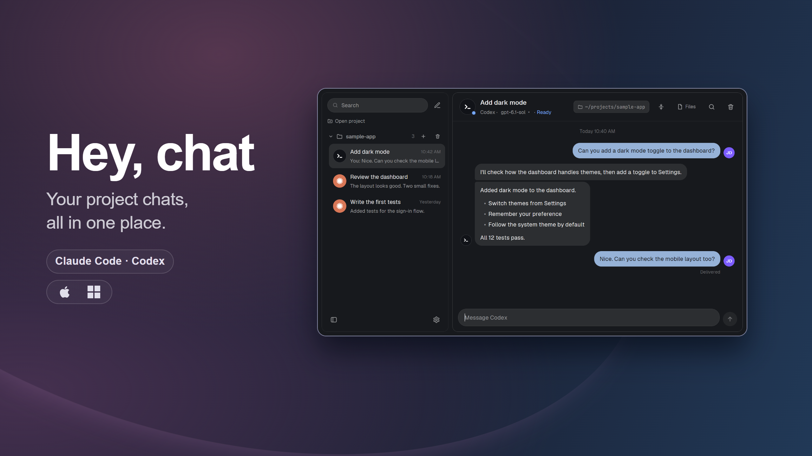

# Hey, chat

A chat with Claude Code or Codex in a Herdr tab, laid out like a messenger.
Each project folder gets its own chat tab with a sidebar of its conversations,
a model picker, permission and question cards, and a message queue. Agents
run in background bridges, so closing a tab leaves them running.

## What you see

A pane that fills its tab, with 10 px padding and 10 px gaps on the theme
`background` (see-through when the layout shows a background picture). Up to
three cards sit side by side: the sidebar, the chat and the Files panel.

**Sidebar**, 320 px wide, 14 px round corners, a 1 px `border` that turns
`foreground` at 20% while the sidebar has the keyboard:

- A 36 px round search box on `raised`, then a 36 px pencil button for a new
  chat in this project. Under it, an "Open project" link with a folder icon.
- One 34 px row per project: chevron, folder icon, the folder name in 13 px
  semibold, the chat count in dim text, and 28 px round `+` and trash buttons.
- Under an open project, one row per chat, newest first: the agent's 34 px
  picture, the title in 14 px, the time in 11.5 px dim text, and a 12.5 px
  preview. An unread chat has a semibold title and a 9 px `accent` dot. The
  preview reads "Waiting for you" in `blocked` or "Thinking…" in `working`.
  The open chat has the `selected` background. A chat that just finished
  shows the jump key in an `accent` badge where its time was.
- While sessions load: typing dots and "Finding your sessions…" or
  "Syncing chats…".
- The delete question, when one is open, on `raised` with a `blocked` border.
- Key hints while the tree has the keyboard, then a bottom row with a 36 px
  sidebar button and a 36 px gear.

**Chat card**, 14 px round corners, the same focus border while the message
box has the keyboard:

- Header: the agent's 40 px picture with a status dot, the title in 16 px
  semibold, then "Claude Code ·" or "Codex ·", the model with a `▾`, and the
  status ("Ready" in `done`, "Thinking…" in `working`, "Waiting for you" or
  "Disconnected" in `blocked`). On the right: the folder path in a mono chip,
  "Files (N)", a search button and a trash button.
- Messages: bubbles with 18 px corners, 5 px on the side that joins the next
  bubble from the same sender. 14 px between groups, 4 px inside one. Yours
  are on the right on `accent`, the agent's on the left on `raised` and
  drawn as Markdown. A 28 px picture sits beside each group's last bubble.
  A bubble is at most 62% of the card's width less 40 px, and at least 240 px.
- Under your last message: "Delivered", or "Read <time>" while the agent
  works. A queued message shows "Queued" and a "Send now" link.
- Tool cards are 340 px wide with an icon, title, `+`/`-` counts in `ansi2`
  and `ansi1`, and a chevron. They are hidden while "Condense chat" is on.
- Permission and question cards on `raised` with a `blocked` border while
  they wait. Permission cards have "Allow once", "Always allow" and "Deny"
  pills and say what "Always allow" covers.
- While the agent works: typing dots in a `raised` bubble, with the current
  activity beside them in dim text.
- An empty chat: the agent's 72 px picture, "New chat in <project>", and a
  Claude Code / Codex switch.
- The message box: rounded 21 px, at least 42 px tall, growing from 1 to 8
  lines. Text is 14.5 px, 15 px on Windows. Scroll and stop hints sit inside
  it in `accent`/dim pairs. Beside it, a 36 px stop button while a turn runs
  and a 36 px send button that is `accent` once there is something to send.
- While a permission waits, the message box is replaced by a bar with the
  question and the three answers.

**Files panel**, 400 px wide, 14 px round corners on `background`. It sits
beside the chat, hides the sidebar when the pane is under 1100 px wide, and
floats over the chat when the pane is under 800 px wide.

- Header: "Files & previews" in 15 px semibold, the count in dim text and a
  28 px close button. Under it, 30 px buttons on `raised`: "Add link from
  clipboard", and "Refresh" once something is selected.
- The list, at most 180 px tall: a file icon (`accent` for a Claude
  artifact, `muted` otherwise), the name in 13 px and the path or link in
  11 px dim text. The selected row has the `selected` background. With
  nothing yet: "Files and preview links from this conversation appear here."
- The selected output: its name in 14 px semibold, a note ("Claude
  artifact", "Web link", "Latest file contents" or "Open in your browser or
  default app"), then "Open file" / "Open in browser" / "Open in Claude",
  "Copy path" / "Copy link", and "Show folder" for files.
- The preview on `raised`: Markdown drawn as Markdown, text files as plain
  text, images up to 336 px wide. Other files say they open in their usual
  app. Links say to open the web version. A preview is cut at 20,000
  characters with "Preview shortened. Open the file to see everything."
- A toast at the top right of the chat, 320 px at most on `popover`, says
  "New: <name>" or "N new files & links" with "View" in `accent`. It goes
  after 4 seconds and a click opens the panel.

**Settings**, a dialog 320 to 620 px wide and 320 to 600 px tall, 20 px
padding, 16 px round corners on `popover`, over the pane dimmed with
`#00000066`. A press beside it closes it. Tabs: General and Shortcuts.

- General: "YOUR PICTURE" with your 72 px picture, "Upload photo" ("Adding…"
  while it copies) and "Use initials" once there is a photo. Dropping a
  picture on the dialog uses it. A 200 px "Initials" box. "Initials color":
  six 26 px swatches (`#7c5cff`, `#2f6fe4`, `#0f7a5e`, `#c2410c`, `#be185d`,
  `#475569`) with a ring on the chosen one. A "Condense chat" switch ("Hide
  tool cards, including file edits. Show activity beside the dots."). An
  "Agent setup" link that opens the setup screen.
- Shortcuts: an "Options" section with "Show key hints", then "Shortcut
  keys": one row per key with its key in a 96 px cap, what it does, and
  "On" or "Off". A click on the row turns it on or off. A click on the cap,
  or `enter`, waits for a new key ("press a key"). `esc` keeps the old key
  and backspace brings back the one it came with.

**Setup**, up to 680 px wide: "Set up Hey, chat", a Codex / Claude Code
choice, the install and sign-in commands with "Copy command", and "Check
again".

## How it behaves

- `ctrl-shift-h` opens the chat tab for the focused pane's folder, named
  "Chat · <folder>", or brings it forward. Pressed in a chat tab, it goes
  back to the tab you came from.
- Each tab shows only its own folder's chats. Your existing Claude and Codex
  sessions for that folder appear on their own. Reopening restores the last
  conversation.
- `enter` sends and `shift-enter` adds a line. A message sent while the agent
  works is queued. "Send now" steers the current turn. Codex takes it with
  `turn/steer` and its tools keep running. Claude's CLI has no steer call,
  so the bridge moves the message to the front of the queue, stops the
  turn, and sends it as soon as the turn has ended.
- Files and links appear in the Files panel after a tool or turn finishes:
  files the agent edited or wrote, Markdown links to files or to pages named
  like an output, preview or report, Claude artifact links, `localhost`
  links, and file names in backticks with a known type (`.html`, `.md`,
  `.png`, `.pdf` and others). Open and Show folder only run after a click,
  and a file's content is never run.
- Typing `/` at the start of the box opens a menu of the agent's skills.
  `up`/`down` or `ctrl-p`/`ctrl-n` move, `tab` or `enter` picks, `esc` closes.
- Pasted or dropped images go with the next message. Clicking one shows it
  big. `esc` closes it.
- Permission cards wait on `y` (allow once), `a` (always allow) or `n`
  (deny). With a question card waiting and the box empty, `1` to `9` pick an
  option. Typing and `enter` answers in your own words.
- `ctrl-p` opens the project list: every tab whose only panes are Hey, chat
  panes, in every space. Picking one closes the dialog, runs `space.select`
  if needed, `tab.select`, `pane.focus` on its chat pane, then
  `hey-chat.focus`. Only the copy whose pane is focused takes that command
  and focuses its message box.
- In the project list each row has a letter as in Jump, never `j` or `k`.
  Typing it goes there. `j`/`k` move, `enter` goes, `ctrl-p` closes. Rows
  show the folder name, its path with `~`, "here" in `accent` on the current
  tab, the space name and the tab's status dot.
- `ctrl-g` opens a chat whose turn finished in the last 10 seconds. `ctrl-o`
  switches between this chat and the one before.
- `ctrl-h` puts the keyboard on the sidebar and `ctrl-l` on the message box.
  `ctrl-j`/`ctrl-k` scroll the chat one message. `ctrl-b` hides or shows the
  sidebar. `ctrl-c` stops the turn. `ctrl-,` opens Settings.
- In the sidebar: `j`/`k`, the arrows, `g` and `G` move, `l` or `enter` opens,
  `h` closes a project, `n` starts a chat, `N` opens another project in its
  own tab, `d` deletes, `v` or `shift` with `j`/`k` selects several, `esc`
  goes back to the box.
- Deleting asks first. `enter` or `y` deletes, `n` or `esc` cancels. It
  deletes the agent's session for good and never touches project files.
- Every key except `ctrl-,` can be moved or turned off in Settings →
  Shortcuts. Keys are kept in Herdr's shared state, so every tab matches.
- The first time, or from Settings → Agent setup, the setup screen checks
  for Node and each agent's sign-in. It never installs anything or sends a
  test message.

## Built from

- `mods/hey-chat/main.js` holds the view's state, message boxes and layout.
  `actions/` adds the view's methods by area: chats, focus, scroll, talk,
  questions, models, setup, attachments, slash, delete, settings, outputs,
  jump and copy.
- `tabs.js` opens and tracks one chat tab per folder in shared state
  `hey-chat.projectTabs`. `picker.js` is the `ctrl-p` list.
- `keys.js` handles every key. `shortcuts.js` lists the rebindable keys
  (ids such as `tree`, `chat`, `jump`, `last`, `projects`).
- `views/`: `tree.js` (sidebar), `chat.js` (chat card), `settings.js`,
  `setup.js` and `outputs.js` (Files panel).
- `agent.js` finds the CLIs, lists and reads sessions, and links each chat
  to its bridge. `bridge.mjs` runs one chat's agent: `claude -p` with an MCP
  `approve` tool as `--permission-prompt-tool`, or `codex app-server`.
  `sessions.mjs` lists sessions from `~/.claude/projects` and
  `~/.codex/sessions`, reads their history and deletes them.
- `messages.js` turns bridge events into messages and cards. `store.js`
  keeps chats and folders in `<appHome>/data/hey-chat/chats.json`, never the
  messages. `me.js` and `pictures.js` hold your profile and the pictures.
- `kit/` is the shared kit, copied from the repo's root `kit/` by
  `node scripts/sync-kit.mjs`.
- `mod.json`: `place: "none"`, `focusable: true`, title "Hey, chat", and a
  popup overlay with width 1, height 1 and `frame: "none"`.
- `keys.json`: `"ctrl-shift-h": "mod.open:hey-chat"`. Ctrl+Shift+C was not
  used because Herdr binds it to terminal copy.
- `install.mjs` needs Node 22 or newer, copies the mod into
  `<HERDR_APP_HOME or ~/.config/herdr-app>/mods/hey-chat` and backs up an
  existing copy and `keys.json`. It keeps any key already bound to
  `mod.open:hey-chat` and then adds none. It refuses if `ctrl-shift-h` is
  taken by something else, or if the mod folder is a link.

## Watch out

- One mod runs as several copies. The key's copy is the launcher overlay: it
  draws an empty element, toggles the tab and closes itself. The project
  list is another copy, opened with `props.projects`. Each chat tab is one
  more. `hey-chat.<command>` reaches every copy, so each checks whether its
  own pane is focused.
- The ctrl keys are handled on the pane's root as they bubble up, so they
  beat the message box (`ctrl-h` and `ctrl-k` delete text there). `ctrl-g`
  and `ctrl-o` are taken even with nowhere to go, since `ctrl-o` inserts a
  line on macOS.
- The picker closes before it shows the tab. The dialog hands the keyboard
  back to where it opened as it closes, which would take it from the tab.
- A mod's `exec` stops after 30 seconds and a turn can wait longer, so each
  chat's agent runs in a bridge started with `hc run --bg --outlive-parent`
  in a hidden terminal. The pane talks to it over a 127.0.0.1 socket, one
  JSON object per line, with a token from the bridge's file. A bridge ends
  30 minutes after no pane is connected and no turn runs.
- On Windows the bridge resets the socket when it exits, so `ECONNRESET`
  counts as gone there. Agents are found as `<name>.exe` on `PATH` or as
  npm's JS entry under `%APPDATA%\npm`, launched without a shell.
- Herdr draws only images under its home, so every image is copied into
  `<appHome>/data/hey-chat/images` first.
- Windows fixes sit behind platform checks. The macOS path is unchanged.
- `child()` takes only an element or a string. Anything else (`undefined`
  from a card with no text, a number) makes Herdr keep the last frame that
  worked until the next good render, so the pane looks frozen. Turn values
  from sessions and bridge events into text before drawing them. The test
  stand-in for `child()` throws the same error.
- Two `actions/` files with a method of the same name stop the mod from
  loading, on purpose.
- Edit the shared parts in the repo's root `kit/`, never the copy.

## Done when

- `herdr-app check hey-chat/mods/hey-chat` passes.
- `node --test hey-chat/tests` passes.
- `ctrl-shift-h` in a terminal opens "Chat · <folder>" with the message box
  focused, and pressed again goes back to the terminal's tab.
- A sent message gets an answer. A message sent during a turn shows
  "Queued", and "Send now" moves it into the turn.
- A permission card answers to `y`, `a` and `n`.
- `ctrl-p` lists chat tabs from every space. Typing a row's letter switches
  space and tab and puts the keyboard in that chat's message box.
- A key changed in Settings → Shortcuts works in every chat tab.
- Running `install.mjs` twice keeps one key binding and leaves a backup.
