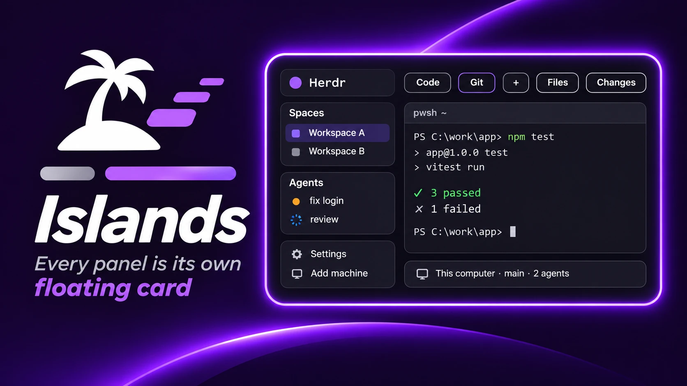

# Islands

Herdr's default window, but every panel is its own rounded card floating on
the canvas with 12 px of air around it, like IntelliJ's Islands look. No
colors of its own: it takes whatever theme you pick, so it works with
graphite, paper, or a theme pack like [cupertino](../cupertino). Six small
mod clones round off the shipped bars and lists so nothing pokes out of a
card, and turn the tab bar's controls into pills.



## What you see

Everything sits 12 px in from the window edge on a flat `canvas` background,
with 12 px between cards. Every card has 14 px corners and a 1 px `border`.
Color names below are Herdr theme names: the picked theme decides the values.
(The screenshot has the cupertino-light theme picked.)

Left column, 268 px wide, four `chrome` cards stacked with 12 px gaps:

- The brand row (46 px, Herdr logo, search, sidebar toggle). It drags the
  window.
- The Spaces list, the selected row `selected`.
- The Agents list. The two lists share the column's height equally, 90 px
  minimum each.
- The footer (72 px, Settings, Add machine).

Right of that, the work column, 12 px between its three pieces:

- The tab bar (30 px) has no fill: the canvas shows through. Every control
  on it is a pill with `surface` fill and a 1 px `border`: each tab (29 px,
  7 px corners), `+` (26 px square, 6 px corners), Files and Changes (26 px,
  6 px corners). The active tab and the open panel button keep the same
  fill and switch their border, text and icon tint to `accent`. That's the
  theme's accent, and a person can pick their own in settings.json:
  `"colors": { "accent": "#20a68e" }` recolors it (and everything else
  accent) on any theme. Hover is `hover` on all of them. The window buttons
  on Windows and Linux stay plain glyphs.
- The focused tab's panes are `background` cards, 12 px apart. The focused
  pane looks the same as the others: no accent ring. Each pane has a 30 px
  header on top (program icon, name, folder, split/zoom/close on hover) with
  its top corners rounded to match. A tab's only pane is framed too.
- Text inside a terminal is inset 16 px top and bottom, 14 px left and
  right. The terminal paints no background of its own (`terminal_opacity: 0`),
  so the card's rounded fill shows through, bottom corners included.
- Files and Changes, when open, are one more card on the right: 368 px,
  drawn by the shipped mods themselves (`background` fill, 10 px corners,
  1 px `border`). Hidden until a tab-bar button opens one.
- The status bar (32 px) is one more `chrome` card at the bottom. Its icons
  carry color on muted text: the machine icon `working`, the branch icon
  `accent`, and the agents dot `done` while agents run, `blocked` when one
  needs you, `dim` with none.

The popups the layout can reach match the cards: the search picker (the
sidebar's magnifier), the `+` menu and the right-click menu on a tab, a
space or a terminal all draw a `popover` card with 14 px corners, a 1 px
`border` and a large shadow. Herdr's own dialogs (the command palette,
settings, welcome, confirm, prompt, toasts, the help sheet) keep Herdr's
frame: a layout can't reach them.

Type is Herdr's own: Geist for the panels, JetBrains Mono 14 px for
terminals. Nothing is set, so settings.json still wins there.

## How it behaves

- It has no `theme`, so it shows settings.json's theme, else graphite in
  dark mode and paper in light. The theme picker (Settings > Look, or
  `app.theme {name}`) sticks to this layout, so pick `cupertino-light` and
  `cupertino-dark` once and it stays that way.
- Agent status comes from the shipped mods' code, in the theme's colors: a
  spinner for working, a `blocked` badge when one needs you, a `done` dot
  until you look, `dim` when idle. Space and tab rows carry the dot, the
  agents card lists them, the status bar counts them.
- Everything else is stock Herdr: `ctrl-shift-b` folds the sidebar to a
  44 px rail (the cards narrow with it), `ctrl-shift-l` cycles layouts,
  panes split, zoom, close and drag like the default layout, Files and
  Changes open from the tab bar and stay open per space.

## Built from

- `layouts/islands.json`: a clone of Herdr's `main` (0.1.13) with
  `cloned_from` and any `theme` dropped, the look set, and six mod references
  swapped for the clones below.
- `mods/islands-*`: `mod.clone` of the shipped `spaces`, `agents`, `pane`,
  `tabs`, `workspace-chrome` and `workspace-status`, each with a few lines
  changed in `main.js`, the rest shipped code:
  - `spaces`, `agents`, `workspace-chrome` (both its brand row and its footer)
    and `workspace-status`: `.rounded(13).overflow_hidden()` before the root's
    `.bg(t.chrome)`, and their `.border_t(1)` / `.border_b(1)` dividers removed.
    13 because they sit inside a 14 px card with a 1 px border. The footer's
    padding becomes `px(8).py(8)`.
  - `pane`: `.rounded_t(13)` before the header's `.bg(t.background)`.
  - `tabs`: the root loses `.bg(t.chrome).border_b(1)`. The `button` helper
    takes a `pill` flag that adds `.bg(t.surface).border(1).border_color(t.border)`,
    used for `+` only. Tab items get `.border_color(c.active ? t.accent : t.border)`,
    `.bg(t.surface)` and `.text_color(c.active ? t.accent : t.muted)`, and a
    tinted program icon gets `.text_color(c.active ? t.accent : t.muted)`.
    Panel buttons get the same three with `on` in place of `c.active`, plus `.border(1)`.
  - `workspace-status`: its `label(icon, text)` helper takes a third `color`
    for the icon (`t.working` for the machine, `t.accent` for the branch), and
    the agents dot is `needs > 0 ? t.blocked : list.length > 0 ? t.done : t.dim`.
- `mods/islands-picker`, `mods/islands-new-menu`, `mods/islands-menu`:
  `mod.clone` of the shipped `picker`, `new-menu` and `menu`. Each root
  gets `.rounded(14).overflow_hidden().border_1().border_color(t.border).shadow_lg()`
  right after its `.bg(t.popover)`, and opens with `frame: "none"` so Herdr
  draws no frame of its own: `islands-picker/mod.json` and
  `islands-menu/mod.json` carry `"frame": "none"` in their `overlay` block
  (the menu's is `{ "width": 220, "height": 260, "frame": "none" }`),
  `islands-new-menu/mod.json` carries the same spec the `+` button passes
  (`{ "kind": "popup", "width": 250, "height": 512, "frame": "none" }`).
  The openers point at them: `islands-workspace-chrome`'s search button
  runs `mod.open` with `islands-picker`; `islands-tabs` and `islands-spaces`
  call `openOverlay` with `islands-new-menu` / `islands-menu` and
  `frame: "none"`; the layout root has `"terminal_menu": "islands-menu"`.
- `layouts/islands.svg`: the 160x100 picture the settings screen shows.

The layout root (`row`, `titlebar: "none"`, `traffic_lights: [12, 16]`):

```json
"background": "canvas", "padding": 12, "gap": 12,
"terminal_padding": [16, 14], "terminal_opacity": 0,
"terminal_menu": "islands-menu", "preview": "layouts/islands.svg"
```

No `divider` on the root or the sidebar: the gaps do that job.

Card paint, used on six blocks: `"background": "surface", "radius": 14,
"border": { "width": 1, "color": "border" }`.

- `sidebar` (`column`, 268 px, min 44, max 480, `resizable: false`, `gap: 12`):
  `brand` block (46 px, `islands-workspace-chrome`, `window_drag`, card),
  `sidebar-lists` column (`gap: 12`) holding `spaces` (`islands-spaces`)
  and `agents` (`islands-agents`) blocks (`weight: 1`, `min: 90`, cards),
  then `sidebar-footer` (72 px, `islands-workspace-chrome` with
  `props: {footer: true}`, card).
- `work` (`column`, `resizable: false`, `gap: 12`): `tabs` block (30 px,
  `islands-tabs`, `window_drag`, no paint), `work-body` row (`padding: 0`,
  `gap: 12`), `status` block (32 px, `islands-workspace-status`, card).
- `work-body` holds `main` (`content.tab: "active"`) and `panel` (`column`,
  368 px, min 280, max 900, `hidden: true`, no paint of its own) with a
  `panel-body` stack of `files` and `changes`.
- The pane frame on `main`:

```json
"pane": { "gap": 12, "radius": 14, "background": "background", "lone": true,
          "border": { "width": 1, "color": "border" },
          "focus": { "width": 1, "color": "border" },
          "header": { "content": { "mod": "islands-pane" }, "height": 30,
                      "position": "top", "reveal": "always" } }
```

Shipped mods used as-is: `files`, `changes`, `machine-add`, `worktree`,
`peek`. The clones run the same code
as their originals: nothing reaches the network or runs programs beyond what
those already do (`git` for branch and worktree info).

## Watch out

- Herdr doesn't clip a mod to its node's `radius`. A mod that paints a
  full-size background (every shipped bar and list does) draws square corners
  over the card's rounded ones. That's the whole reason the clones exist. The
  shipped `files` and `changes` already round themselves
  (`.rounded(10).overflow_hidden()`), so the panel node carries no paint and
  those two keep their 10 px corners.
- The terminal's own background fill is square and Herdr draws it, so no mod
  can round it. `terminal_opacity: 0` is the fix: the terminal paints no
  background and the rounded pane frame shows through. Programs that set
  their own colors (an editor theme) still paint theirs.
- The clones never update with Herdr. After an app update, diff each against
  its shipped original and re-apply the few lines above.
- `shadow` on the pane frame does nothing in 0.1.13 (`sm`, `md`, `lg` all
  render the same as none). Leave it out.
- A root `background` gradient is one value for both appearances, so a light
  wash shows up around dark cards at night. That's why the canvas is flat.
- The tab bar block is 30 px with a 12 px column gap under it, which adds up
  to the stock 42 px. Making the block taller leaves the pills floating in
  empty canvas.
- A key bound to `mod.open:picker` in keys.json still opens the shipped
  picker with Herdr's frame. Rebind it to `mod.open:islands-picker` under a
  `layout:islands` section if you want the rounded one from the keyboard.
- Opening a popup by name (`mod.open`) uses its mod.json `overlay` block;
  opening it from code uses the `openOverlay` spec. Both need
  `frame: "none"`, or Herdr's square-ish frame comes back on that path.
- `layout.clone` copies `main`'s click state (panel width, active panel,
  theme pick) into `layouts/.state/islands.json`. Harmless, but a theme pick
  there is what decides the colors, so that's where to look if the layout
  doesn't change with settings.json.

## Done when

- `~/.config/herdr-app/layouts/islands.json`, `layouts/islands.svg` and the
  six `mods/islands-*` folders are in place, `herdr-app check` passes on
  each mod, and `herdr-app status` lists no errors after
  `herdr-app do layout.switch '{"name":"islands"}'`.
- `herdr-app shot` shows a flat canvas with a 12 px margin, pane cards with
  14 px corners, four cards down the left (brand, Spaces, Agents, footer), a
  status card along the bottom, and a tab bar with no fill whose tabs, `+`,
  Files and Changes are bordered pills, the active tab outlined in the
  theme's `accent`.
- `"colors": { "accent": "#20a68e" }` in settings.json turns that outline,
  text and icon teal within a second, with no other file touched.
  Zoomed in, every card corner is a clean arc with canvas outside it, the
  pane's bottom corners included.
- `herdr-app do app.theme '{"name":"paper"}'` recolors every card without
  touching the shape. Switching back to `main` and returning keeps the pick.
- Clicking Files or Changes opens a third card on the right.
- The sidebar's magnifier, the `+` button and a right-click on a tab open
  popups with the same 14 px corners as the cards.
- Settings > Look shows Islands with the picture from `islands.svg`.
