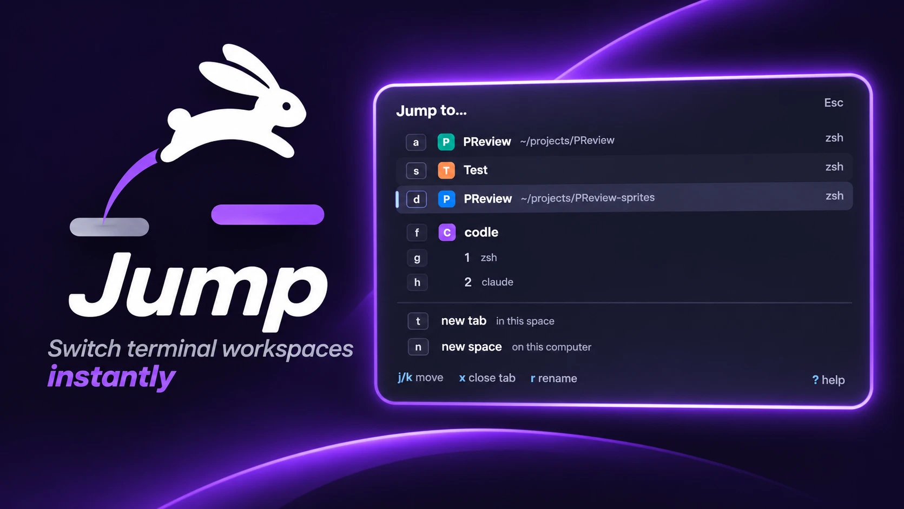

# Jump

A popup that lists every space with its tabs and jumps to one when you type
its letter. tmux's prefix+w with vimium's hints, in place of the built-in picker.

## What you see

A 560 px popup at the top of the window, popover background, 18 px padding.
Top line: "Jump to…" (15 px semibold) and "Esc" at the right in the
dim color.

Every row is 30 px and starts with its hint badge, so the letters form one
column at the left. A space with one tab is one row: the space's colored avatar
(18 px square, its first letter), its name in semibold foreground, and what runs
in it right-aligned in 11 px dim text (program names joined by " · ", or "empty";
a named tab's name first). A space with several tabs has that header without the
detail, then one row per tab under the name column: the tab's name in the muted
color, then what runs in it. Rows show a status dot only when there is a status.
Spaces with the same name also show their folder in dim text, and their branch
when the folders match too. The selected row has the `selected` background, a
3 px accent bar at its left edge and an accent badge. Hover is the `hover` color
at 40% opacity. After a 1 px top border, two more rows: "new tab" and "in this
space" with the letter `t`, and "new space" and "on this computer" with `n`.

Bottom line: `j/k`, `x` and `r` in accent/dim pairs.

## How it behaves

- Opens on the active tab of the active space.
- The status dot, when there is a status, follows the tab's agent status: a spinner for working,
  `blocked`, `done` and `idle` in the theme's colors.
- Typing a row's letter goes to that tab and closes. A space's letter goes
  to its active tab. Hints are single letters while they fit, two beyond,
  never starting with a chosen letter. Chosen letters draw in the accent
  color and come from `~/.config/herdr-app/hints.json`.
- `j`/`k`, arrows and `ctrl-n`/`ctrl-p` move; `Enter` goes; `x` closes
  the selected tab with no confirm and the popup stays open; `t` new tab here; `n` new space; `r` renames the selected tab or
  space (the space, on a one-tab row) in a name box above the list (`Enter` saves, `Esc` cancels, the popup
  stays open; an empty name goes back to Herdr's default); `q` or `Esc` closes.
- Every space is always listed; nothing folds away.

## Built from

- `mods/jump/main.js` and `mods/jump/tiles.js` (the same tiles file as the
  Run mod: hints, badges, navigation).
- `mod.json`: `{ "place": "none", "overlay": { "kind": "popup", "at": "top", "offset": 40, "width": 560, "height": 0.75 } }`.
- `keys.json` opens it: `"ctrl-shift-k": "mod.open:jump"`.
- Data: `spaces()` for spaces and tabs, `panes()` for what each tab runs
  (`program.name`, or `mod`), `agents()` for status, `shared("space.colors")`
  for the avatar colors the shipped mods assign.
- Commands: `tab.select {id}`, `space.select {id}`, `tab.new`, `space.new`,
  `tab.close {id, confirmed: true}`, `tab.rename {id, name}`, `space.rename {id, name}`.
- `hints.json`: `{ "spaces": { "Logos": "l" }, "tabs": { "Logos/Code": "c" } }`,
  read with `readTextFile(appHome() + "/hints.json")`.
- Theme colors only.

## Watch out

- Type-clean under the jsconfig the app writes (`checkJs`, `strict`): every
  function carries JSDoc types, `colors()` in tiles.js casts `theme()` to the
  builders' color type. Check with `npx -p typescript tsc -p jsconfig.json`.
- Elements are single-use: collect each space's rows before building its
  section.
- A popup is sized by content; the list gets an estimated height, capped
  at 560 px with a scrollbar.
- Reserved letters, never hints: `t n q j k x r`.
- The built-in picker stays installed; this mod has its own key instead.

## Done when

- `herdr-app check ~/.config/herdr-app/mods/jump` passes.
- Opening shows every space and tab with a letter each; the active tab is
  selected.
- Typing a tab's letter switches to it; typing a space's letter switches to
  that space; `t` makes a new tab; `n` a new space.
- A space named in `hints.json` shows that letter in the accent color.
