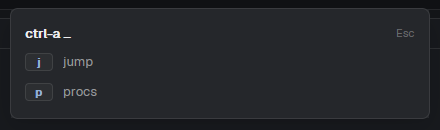

# Leader

A tmux-style prefix key for the Herdr app. One key opens a small popup that
waits for the next key and runs whatever your `leader.json` maps it to.
Herdr binds one key to one command, so this is how a two-key chord works.

## What you see

With `"show": false` in `leader.json`: nothing. The prefix still waits for one
key. Otherwise:

A 420 px popup at the top of the window, popover background, 14 px padding.
First line: the leader key and an ellipsis ("ctrl-a …") in 13 px semibold,
"Esc" at the right in the dim color. Then one 24 px row per mapping: the
key in a small badge (raised background, 1 px border, accent text, at least
28 px wide) and a label in the muted color. The label is the mod's name for
`mod.open:<mod>`, otherwise the command with its verb first ("new tab",
"select space 1"). With no file it says where it looked; with an unreadable
file it shows the parse error in the blocked color.

## How it behaves

- `keys.json` binds the leader: `"ctrl-a": "mod.open:leader"`.
- The next key runs its mapping and closes the popup. Esc, the leader key
  again, or any unmapped key closes it. Bare modifier presses are ignored.
- Mappings in `~/.config/herdr-app/leader.json`, written like `keys.json`
  actions: `"tab.new"`, `"space.select:1"`, `"mod.open:procs"`, or
  `{ "command": "pane.split", "args": { "direction": "right" } }`.
- The key names are `keystroke` spellings (`"j"`, `"shift-x"`, `"%"`).
- `{ "show": false, "keys": { ... } }` keeps the prefix but draws nothing while
  it waits, like tmux. The flat form is the same as `show: true`.

## Built from

- `mods/leader/main.js`, `mod.json`:
  `{ "place": "none", "overlay": { "kind": "popup", "at": "top", "offset": 40, "width": 420 } }`.
- `leader.example.json` beside it maps built-in commands only; copy it to
  `~/.config/herdr-app/leader.json` to start.
- `keys()` finds which key is bound to `mod.open:leader`, for the title and
  the double-tap close. `commands()` names the first argument when an
  action is `name:value`. `run(name, args)` executes.
- Theme colors only.

## Watch out

- Type-clean under the jsconfig the app writes (`checkJs`, `strict`): every
  function carries JSDoc types, and `theme()` is cast to the
  builders' color type. Check with `npx -p typescript tsc -p jsconfig.json`.
- Binding `ctrl-a` takes it from terminal programs (readline's
  beginning-of-line, and tmux inside a terminal). Tell the person.
- A `mod.open:<name>` mapping is hidden while `mods/<name>/mod.json` is missing,
  so a shared file never offers a key that would only error. Any other bad
  binding shows the app's own error toast when pressed.
- The popup closes before it runs the mapping, so a mapping that opens
  another popup works.

## Done when

- `herdr-app check ~/.config/herdr-app/mods/leader` passes.
- With `{"c": "tab.new"}` in `leader.json`, pressing the leader then `c`
  opens a new tab and the popup is gone.
- Pressing the leader twice closes it without running anything.
