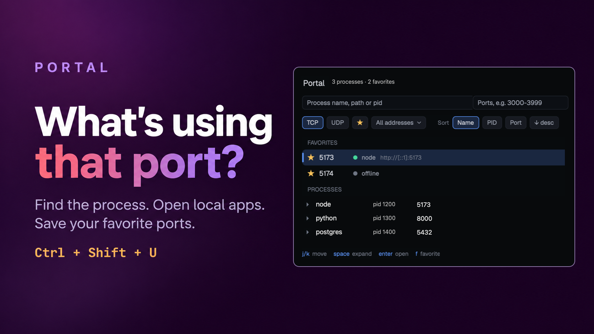

# Portal

A dialog that lists every local TCP listener and UDP socket on the machine,
grouped by the process that owns it. Favorite the ports you care about, open
a local web app in the browser, copy a pid or address, and end the process
holding a port. macOS and Windows.

## What you see

An 860 px wide dialog, 80% of the window tall, no frame of its own: a 14 px
rounded card with a 1 px `border`, 16 px padding and the theme's `popover`
background (at the islands main opacity plus 0.1 when the islands layout
shares one). Top to bottom:

- Title row: "Portal" (15 px semibold), then the counts in 11.5 px dim
  ("12 bindings · 7 processes · 2 favorites", or "5 of 12" when filters cut
  them). At the right the status ("Updated 14:02:11", or in the `blocked`
  color "Stale · last ok …" / "Partial · <error>") and "Esc" in dim.
- Two filter boxes, 26 px tall on the `background` color: "Process name,
  path or pid" filling the row, and a 180 px "Ports, e.g. 3000-3999" box
  whose border turns `blocked` when the range is invalid. The focused box has
  an accent border.
- Chips, 24 px: TCP, UDP, ★ (favorites only), an address dropdown (All
  addresses, Loopback, Wildcard, Specific), then "Sort" with Name, PID and
  Port and an "↑ asc" / "↓ desc" chip. An on chip has an accent border and the
  `selected` background. At the right, a refresh button (↻, a spinner while
  scanning, tooltip "Refresh (every 5s)") and an add-favorite button (+★).
- The list, with a vertical scrollbar:
  - FAVORITES header (11 px dim caps), with "N hidden by filters" at the
    right when some are. One 30 px row per favorite port, lowest first: a
    star, the port in semibold, an 8 px dot (`ansi2` when something listens,
    dim when not), the owner names or "offline" / "not checked yet", and the
    URL in dim.
  - PROCESSES header, with "by lowest port ↑" (or name, PID) at the right.
    One 30 px row per process: ▸/▾, the name in semibold (max 220 px), "pid N",
    an "unverified" tag when its details couldn't be read, its first four
    ports ("+3" past that), and "N hidden" when filters hide some of its
    sockets.
  - An expanded process shows 22 px detail rows indented 44 px (PID, User,
    Started, Path, Command) and then one 28 px row per socket: a TCP/UDP tag,
    IPv4 / IPv6 / IPv4+6, the address (`*:5000`, `127.0.0.1:3000`,
    `[::1]:8080`), a star when favorited, an HTTP / HTTPS / URL / … tag in
    accent, and the URL in dim.
  - Any row whose port is used by more than one socket gets a "Shared port"
    tag.
  - The selected row has the `selected` background and a 3 px accent bar at
    its left edge.
- A message strip, 34 px with an 8 px rounded border, only when there is
  something to say: the last action's result, a question, or an input box.
- Key hints in accent/dim pairs: `j/k` move, `space` expand, `enter` open,
  `f` favorite, `n` add, `e` URL, `x` end, `c` copy, `t/u/m/a` filters, `/ p`
  search, `s` sort, `r` refresh.

Before the first scan finishes the list says "Scanning…". On Linux the card
only says "Portal supports macOS and Windows only for now."

## How it behaves

- It scans when it opens and then every 5 s (the `refresh` setting). A scan
  that fails keeps the last good list and shows the error in the status.
  Results from an older scan never replace a newer one.
- Each TCP socket is probed once in the background, four at a time, with a 1 s
  limit: a bare `HEAD` answered with "HTTP/" is HTTP, otherwise a TLS hello
  answered with a handshake or alert record is HTTPS. That decides the URL
  `enter` opens. A wildcard address opens on `127.0.0.1` (or `::1`).
- `j`/`k` or the arrows move. `space`, `enter` on a process, `l`/`→` and
  `h`/`←` expand and fold. Clicking a row selects it, clicking a process
  folds it, clicking a detail row copies its value.
- `enter` or `o` opens the selected port in the browser. With no HTTP answer
  yet it says "Still checking for HTTP" or "didn't answer as HTTP. Press e to
  set a URL."
- `f` favorites or unfavorites the selected port. `n` asks for a port number
  to add. `e` asks for the URL a port opens (empty clears it). Only http and
  https URLs are accepted.
- `c` copies the pid, the address or the favorite port. `shift-c` copies a
  process's details (name, user, start, path, command, every socket) or a
  port's URL.
- `x` ends the owning process. The strip asks "End node (pid 123)? Sends
  SIGTERM and closes all 3 sockets.", `enter` ends and `esc` cancels. It then
  waits up to 5 s with a spinner. If the process is still there, the strip
  turns `blocked` and offers `f` Force Kill, which asks again and sends SIGKILL
  (`taskkill /F` on Windows). Afterwards it reports "Ports 3000, 3001 are
  free" or which process took a port again. It refuses a socket with no
  owner, a process it can't read, and a pid that now belongs to a different
  process.
- `t`, `u`, `m` and `a` toggle TCP, UDP, favorites-only and cycle the address
  filter. `/` and `p` focus the two filter boxes, `tab` or `esc` leaves them.
  `s` cycles the sort, `shift-s` flips its direction. `r` scans now.
- `q` or `esc` closes. Favorites, URLs and the sort are kept between opens.
  The filters, expanded rows and selection start fresh each time.

## Built from

- `mods/portal/main.js` (the view) and `mods/portal/scan.js` (scanning,
  probing, ending processes).
- `mod.json`: `{ "place": "none", "title": "Portal", "overlay": { "kind":
  "dialog", "width": 860, "height": 0.8, "frame": "none" }, "refresh": 5,
  "star": "accent" }`. `refresh` is seconds between scans and `star` is a
  theme color name or hex for every star. `~/.config/herdr-app/portal.json`
  overrides both.
- `keys.json` opens it: `"ctrl-shift-u": "mod.open:portal"`.
- macOS: `netstat -anv -p tcp` and `-p udp` for sockets and owner pids (TCP
  in LISTEN, UDP with a `*.*` peer). `ps -ww -o pid=,user=,lstart=,comm=` and
  `ps -ww -o pid=,args=` for details. `/bin/kill -TERM` / `-KILL` to end.
- Windows: `netstat -ano` (TCP LISTENING, UDP with a `*:*` peer, `0.0.0.0`
  and `::` shown as `*`). `Get-CimInstance Win32_Process` through `pwsh` for
  name, start, path and command. `taskkill /PID` and `taskkill /F /PID`.
- A process is identified by pid, start time and path, so a reused pid is
  never ended by mistake.
- HTTP probes use the `net` module (`connect`, `write`, `read`, `close`).
- `herdr`: `theme`, `props`, `closeOverlay`, `shared("islands.mainOpacity")`,
  `window().platform`, `readTextFile`, `appHome`, `exec`.
- `gpui-base`: `v_virtual_list` with `VirtualListScrollHandle`,
  `Scrollbar.vertical`, `InputState` / `Input`, `Popover` for the address
  menu.
- `localStorage` keys `favs`, `urls` (by `port|addr`) and `sort`.
- Icons from the shipped `workspace-chrome` mod: `plus.svg`,
  `chevron-down.svg`, `spinner.svg`.
- Theme colors only: `popover`, `background`, `raised`, `border`, `selected`,
  `hover`, `foreground`, `muted`, `dim`, `accent`, `blocked`, `working`,
  `ansi2`.

## Watch out

- It reaches the network only to probe local ports, sends no data beyond a
  `HEAD /` and a TLS hello, and never accepts a certificate.
- It runs `netstat`, `ps`, `kill`, `pwsh` and `taskkill`. Nothing is ended
  without `enter` on the question, and it never moves to a force kill by
  itself.
- `svg()` only loads from inside `~/.config/herdr-app`, and a symlinked mod
  folder points outside it, so the icons come from the shipped
  `workspace-chrome` mod and the rest are text.
- `ps` exits 1 when one of the pids is gone, so its output counts, not its
  exit code.
- macOS process names in netstat can hold spaces. The name ends at the last
  `:pid` before the hex flags.
- Windows skips the process user: the owner lookup takes over a second per
  process, too slow for a 5 s refresh. It needs PowerShell 7 (`pwsh`).
- `net` and `fetch` take no timeout, so a probe races a 1 s timer and closes
  the socket.
- `net`'s `write` takes strings, so the TLS hello keeps every byte below 0x80.
- Rows have fixed heights (30, 28, 22 px) for the virtual list.
- A `"place": "none"` mod lives only as its overlay, so nothing scans while
  it's closed.

## Done when

- `herdr-app check ~/.config/herdr-app/mods/portal` passes.
- `ctrl-shift-u` opens the dialog and the list fills within a second.
- Running `python3 -m http.server 8123` shows a python process with
  `*:8123` and an HTTP tag. `enter` on it opens `http://127.0.0.1:8123`.
- `f` on that row adds 8123 under FAVORITES with a green dot. Stopping the
  server turns it "offline" after the next scan.
- Typing `8000-8200` in the port box leaves only matching rows, and `abc`
  turns its border red.
- `x`, then `enter` on the python process ends it and the strip says "Ports
  8123 are free".
- Favorites and the sort are still there after closing and reopening.
