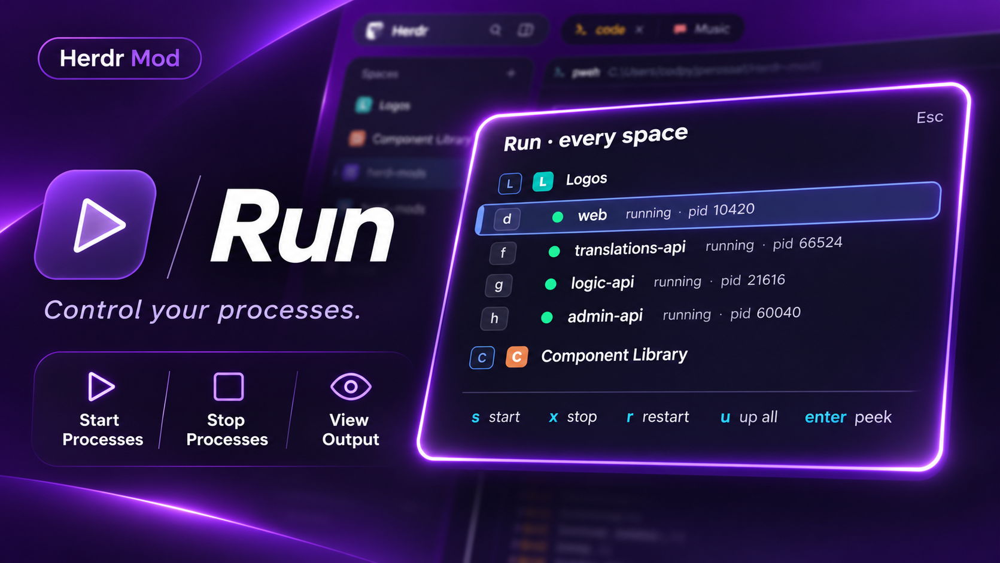

# Run

A popup that runs the processes a repo declares (dev server, API, workers) as
background herdr-core terminals and lets you start, stop, restart and peek at
them with single keys. The mprocs idea, with letter hints instead of a list.

## What you see

A 560 px popup at the top of the window, in the shared kit's frame: popover
background, 16 px round corners, its own border, 22 px padding. Top line: "Run"
(16 px semibold), or "Run · every space" when showing all; at the right "Esc"
in the dim color.

Every row is 32 px with 8 px round corners and starts with its letter badge, so
the letters form one column at the left. One section per space: a header row
with the space's colored avatar (18 px square, the first letter) and its name in
14 px semibold foreground, then one row per declared process under the name
column: a status mark, the name, and a detail in 11 px dim text. Spaces with the
same name also show their folder in dim text, and their branch when the folders
match too. The selected row has the `selected` background and an accent badge.
At the right of the header, a space with no `herdr.procs.json` says so, and one
with nothing running says "nothing running · u starts N".

Bottom, after a thin line: `j/k`, `s`, `x`, `r`, `u`, `enter` and `a` in
accent/dim pairs.
## How it behaves

- Status dot: green (`ansi2`) while running, with "running · pid N"; red
  (`ansi1`) after an exit, with "exited N" or "exited N (stopped)"; dim
  before the first start, "not started"; a spinner while starting, stopping
  or restarting.
- Typing a row's letter selects it. A space's letter selects its first row.
  Letters are single while they fit, two letters beyond that, and never
  start with a letter someone chose. Chosen letters draw in the accent color.
- `j`/`k`, the arrows and `ctrl-n`/`ctrl-p` move. `Enter` peeks at the
  selected process's output over the tab (herdr's own peek). `o` keeps it
  as a tab of its space.
- `s` starts, `x` stops (hc kill), `r` stops then starts, `u` starts every
  `autostart` process in the shown spaces, `shift-x` asks, then stops every
  running one in the selected row's space. `a` toggles between the active
  space and every space (remembered). `q` or `Esc` closes.
- A process that dies on its own while the popup is open posts a toast
  "name exited N" that opens the popup when clicked.
- Processes of a space that was closed are killed and removed the next time
  the popup opens.

## Built from

- `mods/run/main.js` (the view), and `mods/run/kit/`, this repo's shared kit: the
  frame, list rows, letter badges and their navigation, the key legend.
- `mod.json`: `{ "place": "none", "overlay": { "kind": "popup", "at": "top", "offset": 40, "width": 560, "height": 0.75, "frame": "none" } }`.
- `keys.json` opens it: `"ctrl-shift-r": "mod.open:run"`.
- Config, `herdr.procs.json` at the repo root, found by walking up from the
  space's first pane's folder:
  `{ "procs": [ { "name", "cmd", "cwd"?, "autostart"?, "key"?, "env"? } ] }`.
  `cwd` is relative to the repo root; `autostart` defaults to true; `key` is
  the row's hint letter; `env` is an object of variables set before `cmd`.
- Space hint letters: `~/.config/herdr-app/hints.json`,
  `{ "spaces": { "Logos": "l" } }`.
- Starts a process with `hc run --bg --no-parent --outlive-parent --label
  run.space=<space id> --label run.name=<name> --cwd <dir> --json -- <shell>
  <cmd>`; `--on <machine>` for a remote space. The shell is `pwsh -NoLogo
  -Command` when PowerShell 7 answers, else `powershell.exe`, and `$SHELL -c`
  (else `sh -c`) elsewhere. `env` becomes `$env:K='v';` or `export K='v';`
  prefixes.
- Finds a running process by its labels in `terminals()`. Exited ones are
  not in `terminals()`, so the mod remembers each address it started in
  `localStorage` ("terms") and reads their state from `hc ls --all --json`
  every 2 s while open.
- Stop: `hc kill <address>`, then `hc get` every 250 ms until not live (10 s
  limit, then the row says "won't stop"). Start removes an exited terminal
  with `hc rm` first.
- Enter opens a dialog overlay of this mod's own: a layout with a 32 px `run`
  block (props `{ peek: { address, name, space, spaceName } }`) over a terminal
  block. The bar takes the keyboard: Esc or `q` close, `o` keeps the terminal as a
  tab, `b` goes back to the list; clicking the output types into it, clicking the
  bar gets the keys back. `terminal.keep {terminal, place:
  "tab"}` for `o` (after `space.select` when the space isn't active).
- `shift-x` opens the shipped `confirm` mod with `command: { name:
  "run.stopall" }`; the mod handles "stopall" and "up" from `nextCommand()`.
- `notify({ level: "error", action: { name: "mod.open", args: { name: "run" } } })` for the exit toast.
- Theme colors only: `popover`, `raised`, `border`, `selected`, `hover`,
  `foreground`, `muted`, `dim`, `accent`, `ansi1`, `ansi2`, `working`.

## Watch out

- Type-clean under the jsconfig the app writes (`checkJs`, `strict`): every
  function carries JSDoc types, `colors()` in kit/theme.js casts `theme()` to the
  builders' color type. Check with `npx -p typescript tsc -p jsconfig.json`.
- Elements are single-use: collect each space's rows in an array, then
  build the section. Adding children to an element already placed throws.
- A popup is sized by its content, so the list needs an explicit height;
  the mod estimates it from row counts and caps it at 470 px with a scrollbar,
  so the key hints stay on screen.
- `"transparent"` is not a color; an unselected row sets no background.
- A layout overlay sends Esc to its terminal, so the bar mod must own the keyboard
  and close the overlay itself.
- The file is trusted code: `u` and `s` run whatever a cloned repo declares.
  Nothing runs without a keypress.
- Reserved letters, never hints: `s x r u o a q j k`. A chosen `key` on one
  of these is ignored.
- `ctrl-shift-escape` is taken by Windows (Task Manager); bind
  `overlay.close` to something else, such as `ctrl-shift-q`, to close peeks.
- The toast and the orphan sweep only run while the popup is open or
  opening, since a `"place": "none"` mod lives only as its overlay.
- Hints are assigned across every shown space, so in the all-spaces view a
  process `key` loses to a space letter that claimed it first.

## Done when

- `herdr-app check ~/.config/herdr-app/mods/run` passes.
- A space on a repo with `herdr.procs.json` shows one row per entry, "not
  started"; `u` starts the autostart ones and the rows turn green with pids.
- `hc ls --json` shows those terminals with labels `run.space` and
  `run.name` and the `cwd` from the entry.
- `x` on a running row turns it red with "exited 1 (stopped)"; `s` on it
  starts a fresh terminal and the old address is gone from `hc ls --all`.
- A process that exits with code 2 on its own turns red with "exited 2" and
  a toast appears.
- An entry with `"env": { "PORT": "3000" }` sees `PORT` set.
- Closing the space, then opening the popup, leaves none of its terminals in
  `hc ls --all`.
