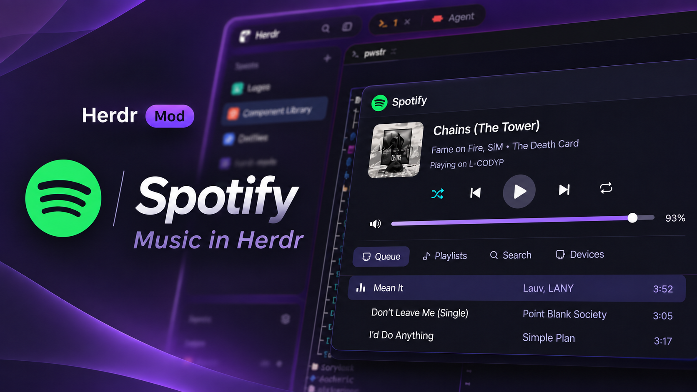

# Spotify

Controls the user's Spotify from Herdr: a now-playing slot for a bar, a hover
card with the playback controls, and a keyboard-driven dialog for the queue,
playlists, search and devices. It plays nothing itself. It remote-controls a
Spotify app that is open on some device, through the Spotify Web API.

## What you see

**The slot.** A layout block with props `{ "slot": true }`. An 18 px album art
square and `Title · Artist`, cut to fit, on the `chrome` color with 13 px round
corners. Paused music keeps its title in the dim color. With no track it shows
"♪" and "Sign in to Spotify", "Nothing playing" or "Spotify unavailable".
Clicking it opens the dialog.

**The hover card.** Resting the pointer on the slot for 350 ms opens a 300 px
card below it (above it with `"card": "above"`, for a bottom bar): 64 px art,
title, artist, album, a progress slider with times, five round buttons
(shuffle, previous, play/pause, next, repeat), a volume slider with the
percent, and "Playing on <device>". It closes 300 ms after the pointer has left
the slot and every part of the card, and at once when the dialog opens.

**The dialog.** 860 px wide, 92% of the window's height, popover background,
16 px round corners, its own border (`"frame": "none"`). Top line: the Spotify
logo in Spotify green (`#1DB954`), "Spotify", and "Esc" at the right. Then:

- The track: 104 px art, an 18 px semibold title, `artist • album`, "Playing on
  <device>", and the five buttons under them (36 px, the play button 48 px and
  filled).
- Two full-width sliders, 5 px lines with a 14 px bright knob: progress with
  the times on both sides, and volume with the speaker icon and the percent.
- Four tabs with icons: Queue, Playlists, Search, Devices. The active one has
  the `selected` background.
- The list: 38 px rows with 8 px round corners, the selected one on `selected`.
  Tracks show title, artist and length. The playing track is in the accent
  color with small level bars before it. The queue's first row is the track
  playing now.
- A line, then one row of key hints. Playback keys show their button's icon in
  place of a word.

**Sign-in.** With no saved sign-in the dialog shows five numbered steps, the
Client ID box, and the keys. Step 1 ends with the dashboard address as a link.
Step 3 shows the redirect URI in a box that copies it when clicked.

## How it behaves

- Keys in the dialog: `h`/`l` (or the arrows) switch tab, `j`/`k` move,
  `enter` acts on the row, `space` play/pause, `n`/`b` next/previous, `[`/`]`
  seek 10 s, `-`/`=` volume 5%, `z` shuffle, `r` repeat (off, the list, the one
  track), `u` `p` `s` `d` jump to Queue, Playlists, Search, Devices, `a` adds
  the selected track to the queue, `backspace` leaves an open playlist,
  `shift-x` signs out, `q` or `Esc` closes.
- `enter` by tab. Queue: skips forward to that track by sending "next" that
  many times, since the API has no jump-to-queue-entry call. Playlists: opens
  the playlist, and on a track plays the playlist from that track. Search:
  plays that one song. Devices: moves playback there.
- `s` puts the keyboard in the search box. `enter` searches and moves to the
  results. `Esc` or `tab` leaves the box.
- Lists load a page at a time. Moving within three rows of the end loads the
  next page.
- Sliders seek or set the volume when let go. A reading that arrives mid-drag
  does not pull the knob back.
- Every command updates the screen at once, then a reading 700 ms later
  replaces that guess with what Spotify reports.
- Sign-in: `enter` checks the Client ID (32 hex characters), opens the browser
  and waits up to 180 s for Spotify's redirect. If the port is taken or the
  redirect is missed, the dialog asks for the browser's address to be pasted.
  `ctrl-o` opens the dashboard, `ctrl-r` copies the redirect URI.

## Built from

- `mod.json`: `{ "place": "none", "overlay": { "kind": "dialog", "width": 860, "height": 0.92, "frame": "none" } }`.
- `keys.json`: `"ctrl-shift-m": "mod.open:spotify"`, and `cmd-shift-m`.
- The slot is a layout block the user adds:
  `{ "type": "block", "size": { "px": 220 }, "content": { "mod": "spotify", "props": { "slot": true } } }`.
- `main.js` picks the part from `props().slot`: `slot.js` or `dialog.js`.
  `dialog.js` is a shell that shows `signin.js` or `browser.js`.
- Sign-in is Authorization Code with PKCE, no client secret. Each user
  registers their own Spotify developer app, because a shared one is capped at
  5 users, and sets its redirect URI to `http://127.0.0.1:43821/callback`.
  Scopes: `user-read-playback-state`, `user-modify-playback-state`,
  `user-read-currently-playing`, `playlist-read-private`,
  `playlist-read-collaborative`, `user-library-read`.
- A mod cannot listen on a port, so a script started with `exec` catches the
  redirect and opens the browser once it is listening: `listener.ps1` run
  inline with `powershell.exe -Command` on Windows, `listener.sh` with `sh` and
  `nc` on macOS.
- `sha256.js` is SHA-256 in plain JavaScript for the PKCE challenge.
- Tokens are saved in `~/.config/herdr-app/data/spotify/auth.json` and
  refreshed when under a minute is left. A file, since the slot and the dialog
  are separate copies of the mod.
- API calls: `GET /me/player`, `/me/player/queue`, `/me/player/devices`,
  `/me/playlists`, `/playlists/{id}/items`, `/search?type=track&limit=10`.
  Commands: `PUT /me/player/play|pause|seek|volume|shuffle|repeat`,
  `POST /me/player/next|previous|queue`, `PUT /me/player` to move devices.
- `now-playing.js` asks `GET /me/player` every 5 s while music plays and every
  30 s otherwise, and redraws only when what is drawn changed.
- Album art: `curl` saves it under `data/spotify/art/` and `image()` draws it.
- The dialog and the slot talk through `setShared("spotify.authChanged")` and
  `"spotify.dialogOpened"`.
- The card is a `Popup` whose open state the slot keeps, with `on_hover` on the
  slot, the card and every button and slider in it.
- Theme colors only, plus Spotify green for the logo: `popover`, `chrome`,
  `raised`, `border`, `selected`, `hover`, `foreground`, `muted`, `dim`,
  `accent`, `input`, `background`, `ansi1`, `ansi2`.

## Watch out

- Controls need Spotify Premium, and the app's owner needs Premium too.
- With no Spotify app open anywhere, `GET /me/player` answers 204 with no body.
  That is "Nothing playing", not an error.
- The refresh call often returns no new refresh token. Keep the old one.
- `crypto.subtle.digest` never returns in the mod runtime, and there is no
  `TextEncoder`. `crypto.getRandomValues` and `btoa` work.
- `fetch` returns text or JSON only and hides response headers, so pictures
  need `curl` and a 429's `Retry-After` cannot be read.
- Commands with no body must still send a length of 0: pass `body: ""`.
- `GET /playlists/{id}/tracks` answers 403 since 2026. Use `/items`, where each
  entry wraps its track in `item`. Tracks are listed only for playlists the
  user owns.
- Search rejects a `limit` above 10.
- A `HoverCard` closes itself when a slider inside it is dragged, and Herdr
  reports the pointer as gone from a card when it moves onto a button or slider
  in it. Hence the `Popup` and the per-part hover.
- A container with round corners clips to a rectangle, not to its corners.
- Elements are single-use, and `Slider` needs all four of its parts.
- The listener takes about 2 s to start, which is why the script opens the
  browser and not the mod.
- `listener.sh` has not been run on a Mac.
- The mod reaches the network (`accounts.spotify.com`, `api.spotify.com`,
  `i.scdn.co`), runs programs (`powershell.exe` or `sh` and `nc`, `curl`, the
  system's open-in-browser command) and writes under
  `~/.config/herdr-app/data/spotify/`.

## Done when

- `herdr-app check ~/.config/herdr-app/mods/spotify` passes.
- With no saved sign-in, the dialog shows the setup steps. A valid Client ID
  and an approved login lead to the player, and reopening the dialog goes
  straight to the player.
- With a track playing, the slot shows its art, title and artist within 5 s of
  a track change.
- The card's buttons and both sliders change playback, and the card stays open
  while the pointer moves inside it.
- Every key listed above works against a running Spotify app.
- With Spotify closed everywhere, the slot says "Nothing playing" and the
  Devices tab says there are none.
