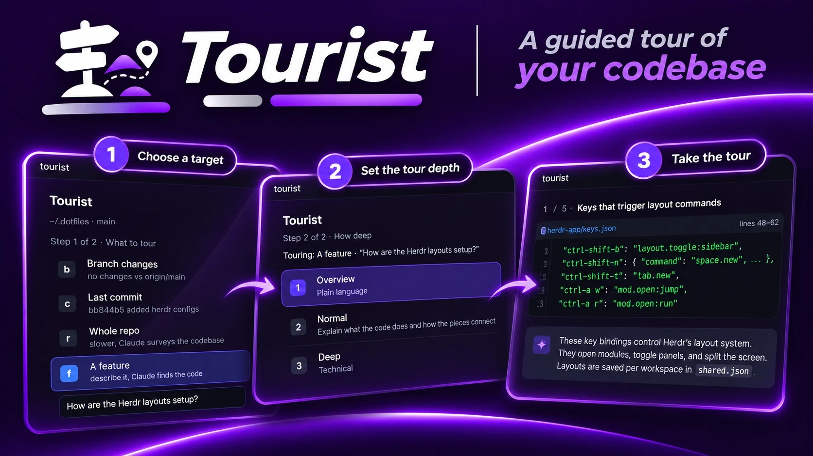

# Tourist

A pane where Claude or Codex gives you a guided tour of code: your branch's
changes, the last commit, an open pull request, the whole repo, or a feature you describe. The agent
picks the stops and their order. You pick the depth, then go deeper, more technical or ask at
any stop.

## What you see

Setup, in two steps (three for a pull request):

1. What to tour: Branch changes (`b`), Last commit (`c`), Pull request (`p`),
   Whole repo (`r`), A feature (`f`). Each row has a letter badge, a title and
   a hint (changed file count, the commit subject). Picking A feature shows a
   text box under the row for the description.
2. Which pull request (PR tours only): the repo's open PRs, "#n title" with
   author, head → base, file count, +/− lines and "draft". The first nine have
   number badges. While loading, or when `gh` fails, the step says so.
3. How deep: Overview, Normal, Deep. A "Touring: ..." line repeats the choices.

Under the repo line, "Tour by Claude" (or Codex). With both CLIs installed it
adds "· a switches" in the accent color.

The highlighted row has the theme's `selected` background and an accent badge.
Row text wraps in narrow panes.

While the agent plans, a spinner and "<Agent> is planning the tour". Then the tour: a header with "n / total", the stop
title and the tour title, the file and line range (click or `o` opens it in VS
Code), the code excerpt, and the explanation below it, capped at 680 px wide.
Stop 1 also shows the tour summary. Answers from Deeper, More technical and Ask
stack under the explanation. A button bar at the bottom repeats the keys.

A PR tour shows "Fetching PR #n" before planning. Each stop has a group badge
(for example "Project setup", "CI") after "n / total", and the code panel shows
the file's diff instead of an excerpt: hunk headers, added lines tinted green,
removed lines red, line numbers and +/− marks. Only the hunks that touch the
stop's lines are shown (all of them when none do). `o` opens the PR's Files
page in the browser, since the PR isn't on disk. There's no cap on the number of
stops: one per changed area worth reviewing.

File list (PR tours): every file the PR changes, on the left of the tour. "In
the tour" lists the tour's files in stop order, numbered by their first stop.
"Also changed" lists the other code files, and "Tests, docs and generated" lists
tests, Markdown and docs, lockfiles, snapshots and build output (`files.js`
decides by path). A file the tour visits stays in the tour group. Each row shows
the folder dimmed, the file name, and +/− line counts (`git diff --numstat`);
skipped files show git's status letter (M, A, D). Clicking a tour file goes to its
first stop. Clicking any other file shows its whole diff in the stop's place,
with "The tour doesn't stop here", and `e` asks the agent for a short
explanation. `a`, `d` and `t` work on it too, in the same agent session as the
tour. Comments work on its lines. Answers about these files are saved with the
tour (`fileNotes` in the saved plan). `j` after the last stop goes on through "Also changed" and then tests, docs and generated, in list order ("Next file", then "Last file"), and `k` walks back the same way. `b` or
"Hide files" hides the list.

Viewed marks: `v` marks the current file viewed (or clears it), and clicking a
row's number or status letter does the same without opening it. A viewed file
shows a green ✓ in place of its number and a dimmed name, and the list's top line
says "N of M viewed". Marks are saved per PR in
`<appHome>/data/tourist/viewed/<repo>_pr-<n>.json` as file → head commit, and
only count while the PR's head is that commit, so a new push clears them. A file
with your saved comments shows their count in an accent badge.

Saved tours: a tour's plan is saved with its Deeper/Ask answers and the agent
session, keyed by the commit it's about and the depth: the PR's head for a pull
request, HEAD for the last commit and the whole repo, and HEAD plus the feature's
text (ignoring case and spaces at the ends) for a feature. Opening the same tour
again skips planning and shows "saved review · r plans again" in the header; `r`
throws the saved plan away and plans again. A new commit or push changes the
key, so it plans again on its own. Branch changes tours aren't saved, because
their uncommitted edits change all the time. If the saved session was made by the
other agent, follow-ups start a fresh session that is told what the tour is about.

GitHub threads: the PR's existing review comments sit under their lines,
read-only, with a neutral border: the author and "on GitHub", then replies
indented below. Outdated ones (no longer on a line of the current diff) are left
out. They reload after you post a review.

Line comments (PR tours): clicking a numbered diff line opens a comment box
under it. `enter` saves, an empty comment or `esc` closes it. Saved comments
sit under their line with an accent border. Clicking one reopens it in the box
with its text to edit (an empty save leaves it as it was), and `×` deletes it. The
file line reads "click a line to comment, shift-click to extend (N saved)".
Each comment keeps the file, line, side (`new`, or `old` for a removed line),
that line's code and the text. Deeper and Ask include your comments on the
stop's file.

Multi-line comments: with a comment box open, shift-clicking another line turns
it into a range from the line first clicked to that one, keeping what you typed.
The range stops at a hunk header, because GitHub only takes a range inside one
hunk. The covered lines get an accent bar on the left, the box and the saved
comment sit under the last line, and the comment shows "Lines 12-18" above its
text. It saves `startLine`/`startSide` and the code of every line in the range.

Post review (PR tours): `p` or "Post review (N)" opens a screen that lists your
comments, a verdict (1 Comment, 2 Approve, 3 Request changes; Comment only on
your own PR, since GitHub refuses the others from the author) and an optional
summary box (`tab` types, the placeholder "See the inline comments." is used
when it's empty). The header names the author and the `gh` account that will
post. `p` asks "Press p again to post <verdict> to GitHub", and the second `p`
posts every comment as one review on the lines they sit on. Then it says
"Posted to GitHub", `o` opens the review, and the posted comments are cleared.
Changing the verdict asks for the two presses again.

Fix (your own PRs only): `f` or "Fix N comments" opens the fix screen. A PR is
yours when its author is the signed-in `gh` account, so a peer's PR never shows
Fix. An agent that can
edit files works through every saved comment in a git worktree on the PR's
commit, so your checkout is never touched. While it runs: a spinner, "<Agent>
is working through N comments", and the worktree path in the header. `b` goes
back to the tour meanwhile, and the button turns into "Fixing…", then "View
fix". When it's done: the agent's one line per comment, then each changed
file's diff. `r` (or `a`, `/`) opens a reply box: the reply goes into the same
agent session, which can keep editing the same worktree. The screen then shows
"You replied: …", the agent's answer, and the updated diff. `p` asks "Press p again to push to <branch>", and the second `p`
commits ("Address review comments on #n") and pushes to the PR's branch, then
removes the worktree and clears the comments. `x` discards the fix: the worktree
and its branch are deleted, and the comments stay.

## How it behaves

- Setup: `j`/`k` or the arrows move, a row's letter (1 to 9 for PRs) jumps to
  it, `enter` picks. On the last step `enter` starts the tour, and `esc` goes
  back a step. `a` (or a
  click on the agent line) switches between Claude and Codex when both are
  installed. The choice is saved in `localStorage` under `agent`.
- Feature box: `tab` on the feature row types into it, `tab` or `esc` gives the
  keys back to the list. `enter` in the box goes to step 2.
- Planning: `q` or `esc` cancels.
- Tour: `j`/down next (past the last stop, into the other files), `k`/up previous, `d` deeper, `t` more technical,
  `a` or `/` ask (the box only exists while asking), `o` open in VS Code, `s` switches split and stacked
  (wide panes start split), `q`
  ends the tour and returns to step 1. On PR tours, `p` posts a review, `r` plans again, and `f`
  (your own PRs) opens the fix. `b` shows or hides the file list, `v` marks a file viewed, and `e`
  explains a file the tour skipped.
- Post review: `1` to `3` or `j`/`k` pick the verdict, `tab` types the summary,
  `p` twice posts, `o` opens it once posted, `b` or `esc` back to the tour.
- Fix: `r`, `a` or `/` replies to the agent (`esc` or `tab` gives the keys
  back), `b` or `esc` back to the tour, `p` twice pushes, `x` discards.
- Every screen: `z` zooms the pane to fill the tab and back (Herdr's `pane.zoom`,
  the same as `ctrl-shift-z`), except while typing in a box.
- Error: `enter`, `q` or `esc` starts over.
- Branch changes is skipped (enter does nothing) when the branch has no
  changes. The default scope is commit or repo in that case.

## Built from

- `mods/tourist/main.js`, one `View` with the state, keys and flow. It uses
  `constants.js`, `git.js` (folder and repo facts), `agent.js` (finding and
  calling the agent), `plan.js` (prompts, reading the plan), `code.js`
  (excerpts, VS Code, opening a URL), `pr.js` (gh), `diff.js` (diff rows),
  `comments.js` (saving line comments), `worktree.js` (the fix's worktree, push
  and discard), `review.js` (posting to GitHub), `ui.js` (shared pieces) and
  `views/` (setup, tour, diff, fix, review, planning and error).
- `mod.json`: `{ "place": "none", "focusable": true, "title": "Tourist" }`.
- `keys.json` opens it in a split: `"ctrl-shift-g": { "command": "pane.split",
  "args": { "direction": "right", "mod": "tourist" } }`.
- The folder is the pane's `props().folder`, else the focused pane's cwd. Git
  finds the root, branch, base (`origin/HEAD`, `main` or `master`), merge-base
  and changed files.
- The agent is whichever of `claude` and `codex` the job shell finds
  (one `command -v` loop, or one `Get-Command claude,codex` on Windows), Claude
  first unless the saved choice says otherwise. PowerShell runs with `-NoProfile`
  (a profile can take seconds), and which one exists (pwsh, else powershell.exe)
  is learned once. The repo and agent checks run at the same time, and the
  independent git calls run together; setup shows a spinner until both finish.
- Claude runs as `claude -p --output-format json --allowedTools Read Grep Glob
  "Bash(git diff:*)" "Bash(git log:*)" "Bash(git show:*)" "Bash(git status:*)"`.
  Follow-ups add `--resume <session_id>` so Claude keeps the context.
- Codex runs as `codex exec --sandbox read-only --json -o <last.txt> -`.
  Follow-ups run `codex exec resume <thread_id> -c 'sandbox_mode="read-only"'
  --json -o <last.txt> -`. The id comes from the `thread.started` event, the
  reply is the `-o` file, and a `turn.failed` or `error` event is the error.
- `exec` stops anything over 30 s, so the agent runs in a hidden terminal: `hc run
  --bg --no-parent --outlive-parent --cwd <root> --json -- pwsh -NoLogo
  -NoProfile -Command <script>` (`sh -c` off Windows). The prompt and reply go
  through files in `<appHome>/data/tourist/`. The mod polls `hc wait <address>
  --timeout 20` until it ends, then `hc rm`.
- The plan is the `{...}` JSON in the agent's reply: a title, a summary and stops
  with `file`, `start`, `end`, `title` and `body`.
- Pull requests: `gh pr list --state open --json ...` lists them in the repo
  root. Starting a tour runs `gh pr view <n> --json ...`, then `git fetch origin
  +refs/pull/<n>/head:refs/tourist/pr-<n> <base>` and `git merge-base
  origin/<base> <head>`. Nothing is checked out. Each stop's diff is `git diff
  <merge-base> <head> -- <file>`. The prompt gives the agent the description
  (fenced off as the author's text, not instructions), commits and files, tells
  it to read with `git diff` and `git show <head>:<file>`, and asks for stops in
  the order the changes build on each other, each with a `group`. Saved plans
  live in `<appHome>/data/tourist/plans/`, named `<repo>_pr-<n>-<head>-<depth>`,
  `<repo>-commit|repo-<head>-<depth>` or `<repo>-feature-<text hash>-<head>-<depth>`.
  Threads come from `gh api --paginate repos/<owner>/<repo>/pulls/<n>/comments`.
- Fix: `git worktree add -B tourist/fix-pr-<n> <appHome>/data/tourist/worktrees/<repo>_pr-<n>
  <head>`, reused if it already exists. The agent runs there with edit tools:
  Claude adds `Edit MultiEdit Write` to its allowed tools (still only `git diff`
  and `git status` for Bash), Codex runs with `--sandbox workspace-write`. The
  prompt lists each comment (file:line, code, text) and says not to commit or
  push. The result is `git add --intent-to-add --all` then `git diff HEAD`.
  Push runs `git add --all`, `git commit`, `git push origin
  HEAD:refs/heads/<branch>`, then `git worktree remove --force` and `git branch
  -D`. Discard runs the last two.
- Review: `gh api user --jq .login` decides whether the PR is yours. Posting
  writes `{commit_id: <head>, event, body, comments: [{path, line, side:
  RIGHT|LEFT, body, start_line?, start_side?}]}` (the start fields only on
  multi-line comments) to a temp file in `<appHome>/data/tourist/` and runs `gh
  api repos/<owner>/<repo>/pulls/<n>/reviews -X POST --input <file>`, then
  deletes the file. Your comment text goes up as written; no agent is involved.
- Code excerpts use `EditorState`/`Editor`, read-only, without line numbers.
  Text uses `TextView.markdown`.
- `herdr-app do tourist.<command>` drives it for testing: `scope-<id>`,
  `depth-<id>`, `down`, `up`, `pick`, `back`, `start`, `next`, `prev`,
  `deeper`, `technical`, `open`, `reset`, `agent` (switch agents), `fix`,
  `fix-back`, `fix-discard`, `review`, `review-back`, `viewed`, `file-<n>` (the nth file in
  the file list, from the top), `explain`. There is no push or post
  command: both take two key presses in the pane.

## Watch out

- Needs the `claude` or `codex` CLI on `PATH`, signed in. Claude only gets read
  tools and read-only git commands. Codex runs in its read-only sandbox, so it
  can run any command that doesn't write.
- Every tour and follow-up is an agent call and uses your plan's usage. Whole
  repo is the slowest.
- `o` runs `code -g`, so it needs VS Code's `code` on `PATH`.
- Pull requests need `gh` on `PATH`, signed in to an account that can see the
  repo. A PR tour leaves a `refs/tourist/pr-<n>` ref in your repo; `git
  update-ref -d refs/tourist/pr-<n>` removes it.
- Line comments are saved to `<appHome>/data/tourist/comments/<repo>_pr-<n>.json`
  and stay on this computer until you post them as a review.
- A review posts as the signed-in `gh` account, and GitHub shows it to everyone
  on the PR. It can't be unposted from Tourist; edit or delete it on GitHub.
  GitHub only takes lines inside the diff, which is where Tourist lets you
  comment. If the author pushed since the tour started, the comments land on
  the older commit and GitHub marks them outdated.
- A fix is the one place Tourist changes code. It edits only the worktree, and
  nothing leaves your machine until you press `p` twice. Pushing needs write
  access to the PR's branch (a PR from a fork will be rejected). If the branch
  moved since the tour started, the push is rejected and the fix stays.
- Closing the pane or starting a new tour keeps an unpushed worktree. The next
  fix on that PR reuses it as is.
- Panes that are already open keep the old code after an edit. Close the pane
  and reopen it.

## Done when

- `herdr-app check ~/.config/herdr-app/mods/tourist` passes.
- `ctrl-shift-g` opens the pane on step 1 with the current repo and branch.
- `c`, `enter`, `enter` plans a tour of the last commit, and the first stop
  shows the file, code and explanation.
- `d` adds a "Deeper" note that builds on the stop. `q` returns to step 1.
