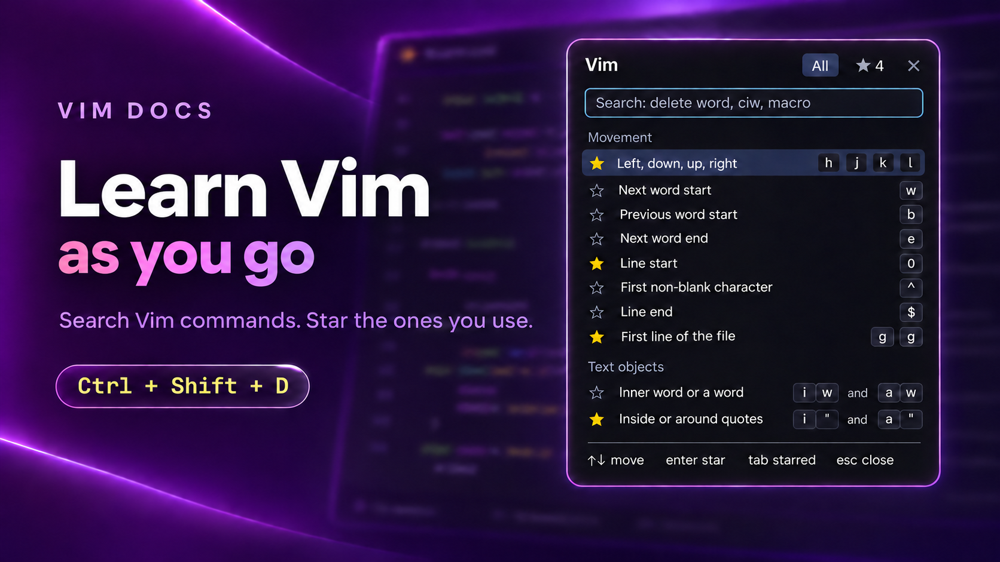

# Vim Docs

A small window of Vim commands to keep open while you work, with search and a starred list.



Open it with `ctrl-shift-d` (`cmd-shift-d` on macOS). Drag it by any empty spot and it opens there next time. The search box always has the keyboard. `up`/`down` or `ctrl-j`/`ctrl-k` move, `enter` stars or unstars a row, `tab` switches between All and Starred, `esc` clears the search, then closes.

## Install

Tell your agent:

```text
Read ~/.config/herdr-app/AGENTS.md, then add this mod: https://github.com/CodeyPacker/herdr-mods/tree/main/vim-docs
```

By hand: copy `mods/vim-docs` (or symlink it) into `~/.config/herdr-app/mods/`, then add the key from [`keys.json`](keys.json) to your `~/.config/herdr-app/keys.json`.

[`RECIPE.md`](RECIPE.md) has the full details, including what it runs on your machine.
