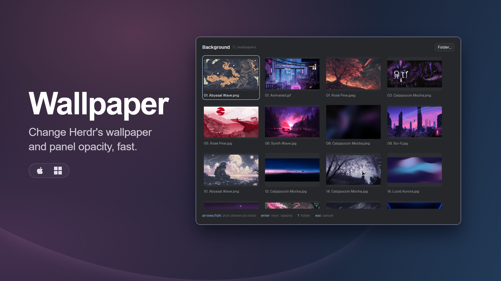

# Wallpaper

A window that picks Herdr's background picture from a folder, then how much
of it shows behind the terminals, then the border color. Every choice shows
at once. Enter keeps it all and Esc puts back what was there.

## What you see

A window overlay, 900 px by 640 px, that does not dim the window behind it,
so the preview is true to life. It fills with the theme's `popover` color,
20 px padding, 14 px gaps and 13 px text.

**Title row.** The step's title in 16 px semibold ("Background", "Pane
opacity" or "Borders"), then the picture folder in 12 px dim text, cut off
when long. On the pictures step a bordered "Folder…" button sits at the
right: 28 px tall, 8 px round corners, `raised` fill, `accent` border on hover.

**Step 1, pictures.** A grid of four columns with 12 px gaps that scrolls
up and down. Each cell is 196 px wide with 4 px padding, 10 px round
corners and a 2 px border, `accent` when selected and clear otherwise.
Inside: a 186 by 116 px thumbnail with 6 px round corners on a `raised`
fill, then the file name in 12 px (`foreground` when selected, `muted`
otherwise) and a dim "now" beside the picture the layout shows today.

**Step 2, opacity.** Centered: the picture's name in 13 px `muted`, the
percent in 40 px semibold, a 520 by 8 px track in `raised` filled with
`accent` up to the percent, and under it "0%: the picture shows fully
behind the terminals" at the left and "100%: solid" at the right in 12 px dim.

**Step 3, borders.** Centered: "<name> at <n>%" in 13 px `muted`, then
four 36 px buttons with 8 px round corners: Theme, Light, Dark, None. The chosen
one has an `accent` border and the `selected` fill. The others have a
`border` border and the `raised` fill.

**Loading and errors.** "Loading…" in dim text while the folder is read.
An error replaces the grid in the `blocked` color: no folder, no pictures,
or a copy that failed.

**Bottom row.** Key hints in 12 px, each key in `accent` and what it does in dim:

- Pictures: `arrows/hjkl` pick (shows at once), `enter` next: opacity, `f` folder, `esc` cancel.
- Opacity: `left/right` 5%, `shift` 1%, `enter` next: borders, `b` back to pictures, `esc` cancel.
- Borders: `left/right` pick, `enter` keep, `b` back to opacity, `esc` cancel.

## How it behaves

- Opens on the picture the layout shows now, when it is in the folder, and
  on the layout's current opacity and border choice.
- The folder starts as `~/Pictures/herdr`. `f` or the button asks for
  another with the system folder picker and remembers it.
- Pictures are `.png`, `.jpg`, `.jpeg`, `.gif`, `.bmp` and `.webp`, sorted
  by name with numbers in order.
- Pictures step: left/right or `h`/`l` move one, up/down or `k`/`j` move a
  row of four. Each move sets that picture as the background straight away.
  Clicking a cell selects it and goes back to the pictures step. Enter goes
  to the opacity step, and applies the picture first if nothing was applied yet.
- Opacity step: left/right, `h`/`l` and up/down, `k`/`j` change it by 5%.
  Shift with left/right or `h`/`l` changes it by 1%. It stays between 0 and
  100 and shows at once. Enter goes on. `b` or backspace goes back.
- Borders step: left/right or `h`/`l`, or a click, picks Theme, Light, Dark
  or None and shows at once. None hides the borders: they blend into the panes. Enter keeps everything, shows a "Background set"
  toast with the picture, percent and border, and closes. `b` or backspace goes back.
- On one of Herdr's own layouts (`main`, `terminals`, `win98`), nothing can
  change, so the window shows "Background" and a note instead: the layout is
  one of Herdr's own, and its picture, pane opacity and borders can't be
  changed by a mod. A "Make a copy" button on `accent`, or `c`, runs
  `layout.clone` into `<name>-copy` (with `-2`, `-3` when taken), which
  switches to the copy. The switch closes the window, so it opens again on
  the copy, and a "Layout copied" toast names it. Ctrl+Shift+L switches back.
- Esc, or closing the window any other way, puts back the layout and the
  shared see-through record as they were when it opened, unless the change was kept.
- `herdr-app do wallpaper.<key>` presses that key (`left`, `right`, `up`,
  `down`, `enter`, `b`, `f`), so it can be driven without a keyboard.

## Built from

- `mods/wallpaper/main.js`, one file.
- `mod.json`: `{ "place": "none", "title": "Wallpaper", "overlay": { "kind": "window", "width": 900, "height": 640 } }`.
- `keys.json` opens it: `"ctrl-a w": "mod.open:wallpaper"`. The
  herdr-background Claude skill opens it too.
- Applying a choice builds a new layout from a copy of the one it opened
  with, so going back to 100% gives the panes their colors back:
  - `background` becomes `{ image: "backgrounds/<name>", fit }`, keeping the
    old `fit` or `"cover"`.
  - Below 100%: `terminal_opacity` 0, and the pane frame on the block whose
    content is the tab gets the theme's `background` with the opacity as
    the hex alpha (`#rrggbbaa`). At 100%: `terminal_opacity` 1 and the frame
    gets `"background"`. Every pane's own `background` is removed either way.
  - On a copy of one of Herdr's own layouts (its `cloned_from.name` is
    listed in `installed.json`), the sidebar, tab bar, status bar and pane
    headers are built in and draw in theme colors, so below 100% the root's
    `colors` gets `chrome`, `canvas` and `surface` at the opacity (the
    theme's `#rrggbb` plus the alpha), and `background` at alpha `00`. The
    shipped pane header fills a square bar with `background`, which would
    show past the frame's round corners, so it is clear and the frame's
    rounded fill does the tinting. The color stays in each value so the
    theme's color can be read back with `.slice(0, 7)`. At 100% those 8-digit
    overrides are taken out again.
  - Also below 100% on such a copy, a node's own `background` that names a
    chrome color (the sidebar column's `"chrome"`) is removed. The mods inside
    fill with the same color, and two see-through layers made the sidebar
    darker than the tab bar. Every node's `divider` (the line between the
    sidebar and the bars) gets the faded `chrome` color too: a divider has
    nothing under it, so a see-through one showed the picture as a bright
    seam. It is recolored, not removed, so it can still be dragged.
  - Also on such a copy, Light and Dark set the root's `colors.border` to
    the chosen color, since Herdr's bars and the mods draw borders in the
    theme's `border`. Theme takes that override out. Islands and other layouts whose chrome is
    made of mods are left alone: those mods follow `backgrounds.seeThrough`.
  - Borders: every `border`, `divider` and `focus` whose color is
    `"border"`, `#ffffff26` (Light) or `#00000059` (Dark) gets the chosen
    color. Others, such as an accent focus ring, stay.
  - None has no color of its own. Below 100% the borders are clear
    (`#rrggbb00`, the theme's background at alpha 0): a border is drawn on
    top of the pane's fill, so one in the same see-through color stacked into
    a darker line. At 100% they are `"background"`, the solid fill's color.
    A clear border, or one equal to the frame's fill, reads back as None, and
    that color is recolored like the others on the next change.
  - `run("layout.set", { layout })` shows it and saves the layout file.
- Shared state `backgrounds.seeThrough`: `{ layout: shared("layout"), opacity: 0..1 }`,
  with `opacity: 1` at 100% rather than `null`. Other mods (the kit's
  `colors()`, the Islands chrome) read it to match their fills. The kit
  treats 1 as solid. Islands uses the recorded opacity, 1 included, before
  its own `islands.opacity`, so at 100% its islands are solid too. With
  borders None the record also has `borders: "none"`: mods that read it hide
  their own borders (the kit's `colors()` returns a clear `border` and
  `bordersHidden()` is true, outside dialogs; the Islands tabs and pane
  headers make their `edge()` clear). With Light or Dark it has `borders:
  "light"` or `"dark"` and `borderColor` (`#ffffff26` or `#00000059`), and
  the kit's `colors()` uses that color as `border` (`chosenBorder()`), also
  outside dialogs. Theme records neither. Accent and other state borders stay.
  Mods that don't read it keep their borders: Wallpaper doesn't guess at them.
  `setShared` also redraws every mod, which a layout change alone does not.
- The border choice is read back from the `main` block's
  `content.pane.border.color`.
- Files, all under Herdr's folder (`appHome()`):
  - `backgrounds/<name>`: the chosen picture is copied here, because Herdr
    only reads pictures from its own folder.
  - `data/wallpaper/settings.json`: `{ "folder": "..." }`.
  - `data/wallpaper/thumbs/<hash>.png`: one per picture, named by a
    djb2-style hash of its path in base 36. On macOS `sips` scales it to
    200 px tall and crops it to 320 by 200. Elsewhere the picture itself is copied and drawn small.
- Thumbnails are made by four workers at a time, so the first rows show soon.
- Commands: `layout.set {layout}`, and on Herdr's own layouts
  `layout.clone {name, as}` then `mod.open {name: "wallpaper"}`.
- APIs: `layout`, `layouts`, `run`, `shared`, `setShared`, `theme`, `appHome`, `home`,
  `exec`, `pickFolder`, `readTextFile`, `writeTextFile`, `notify`,
  `window().platform`, `nextCommand`, `closeOverlay`, and `fs/promises`.
- Theme colors only.

## Watch out

- `layout.set` changes only click and look fields on Herdr's own layouts and
  refuses this change with a "layout.set failed" toast on every step. Herdr
  lists the layouts it ships in `installed.json` as `layout:<name>`. Read it
  when the window opens and offer the copy instead of calling `layout.set`.
- `herdr-app check` runs `init` for real, so `init` returns before reading
  or changing the layout when `checking()` is true.
- Herdr's fs has no `copyFile`. On Windows `fs.writeFile` writes binary data
  as an empty file, so copies go through `cmd /d /c copy /b /y` with
  backslash paths. macOS reads and writes the bytes.
- On Windows `backgrounds/` can be a link out of Herdr's folder, and Herdr
  refuses `mkdir` there even when it exists, so it is only made when missing.
- A thumbnail is named after the picture's path, so a picture replaced under
  the same name keeps its old thumbnail until `data/wallpaper/thumbs` is emptied.
- Herdr draws a terminal's own background square, and a second time with the
  frame's. Clear terminals over one see-through frame give a single fill with round corners.
- A window gets Esc itself, and the mod takes the keyboard 100 ms after it
  opens. While it is open, typed keys go to it, not to the terminal behind.
- The layout is restored in `close()`, so every way of closing it, not only
  Esc, puts the old look back.

## Done when

- `herdr-app check ~/.config/herdr-app/mods/wallpaper` passes.
- Opening shows the folder's pictures with the current one selected and
  marked "now".
- Moving through the pictures changes the background at once. Lower opacity
  shows the picture through the terminals. Light and Dark change the borders.
- Enter on the borders step keeps the look after a restart. Esc at any step
  puts back exactly what was there.
- `f` picks another folder, and it is still chosen the next time it opens.
