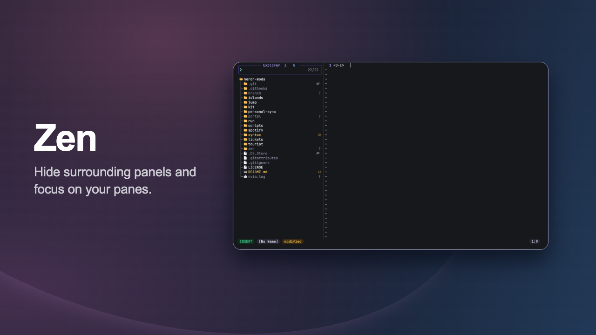

# zen

VS Code's zen mode for Herdr: one key hides everything but your panes, and the same key brings it all back.



VS Code's zen mode for Herdr. Press `ctrl-shift-enter` (`cmd-shift-enter` on macOS) and everything but your panes goes away: sidebar, tab bar, status bars, side panels. Press it again and it all comes back. Works in any layout.

Anything you'd already hidden stays hidden when you leave zen. If your layout draws its own window buttons in the tab bar, those hide too until you press the key again.

## Install

Tell your agent:

```text
Read ~/.config/herdr-app/AGENTS.md, then add this mod: https://github.com/CodeyPacker/herdr-mods/tree/main/zen
```

By hand: copy `mods/zen` (or symlink it) into `~/.config/herdr-app/mods/`, then add the key from [`keys.json`](keys.json) to your `~/.config/herdr-app/keys.json`.

[`RECIPE.md`](RECIPE.md) has the full details, including what it runs on your machine.
