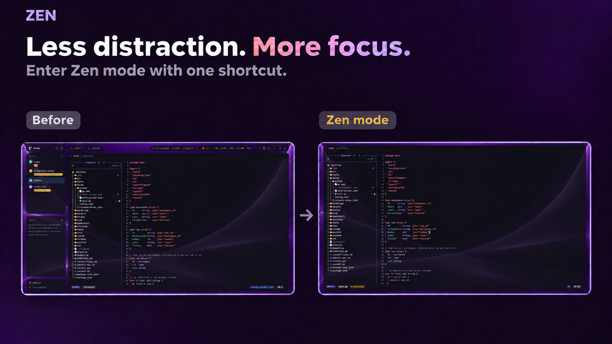

# Zen

One key hides everything in the window except the panes of the tab you're on:
the sidebar, the tab bar, status bars, side panels. The same key brings them
back. Works in any layout.

## What you see

Nothing of its own. Press `ctrl-shift-enter` (`cmd-shift-enter` on macOS) and
every part of the layout around the active tab's panes is hidden, so the panes
fill the window. Press it again and exactly those parts come back.

## How it behaves

- On: every layout part that is showing and isn't on the way from the layout's
  root to the block showing the active tab is hidden.
- Off: only the parts zen hid are shown again. A part that was already hidden
  before zen (a sidebar you closed with `ctrl-shift-b`) stays hidden.
- Agent status, clicks and hovers: none. It has no UI.
- Switching layouts while zen is on: the next press starts zen in the new
  layout instead of restoring parts that belong to the old one.

## Built from

- `mods/zen/mod.json`: `"place": "none"`, and an overlay of `kind: "popup"`,
  1×1 px, `frame: "none"`.
- `keys.json`: `"ctrl-shift-enter"` and `"cmd-shift-enter"` run
  `mod.open:zen`.
- `mods/zen/main.js`: each press opens a fresh copy as that overlay. Its
  `init()` toggles and then calls `closeOverlay(props().overlay)`. `render()`
  returns an empty `div()`.
- Toggle on: `layout()` gives the tree. Find the path from the root to the
  block whose `content.tab` is `"active"`. At each node on the path, every child
  that is not the next node on the path, has an `id` and isn't `hidden` gets
  `run("layout.hide", { id })`. The hidden ids are saved with
  `setShared("zen", { layout, hidden })`.
- Toggle off: when `shared("zen").layout` matches the current layout,
  `run("layout.show", { id })` for each saved id, then `setShared("zen", null)`.
- `layout` in the saved value is every node id in the tree, joined with commas.
  It tells two layouts apart without needing the layout's name.

## Watch out

- Key commands (`<mod>.<command>`) only reach copies of a mod that are
  showing. A mod placed in a layout block would hide itself and miss the
  next press, so zen is an overlay that opens, acts and closes.
- `props()` is null outside an overlay (a layout block, `herdr-app check`), so
  `init()` does nothing without `props()?.overlay`.
- Layouts with `"titlebar": "none"` draw their own window buttons and drag
  area in a bar. Zen hides that bar, so the window can't be moved or closed by
  mouse until zen is off.
- Nodes without an `id` can't be hidden and stay.
- Zen state lives in `shared()`, so it persists across restarts. If you showed
  a part by hand while zen was on, the next press shows the rest.

## Done when

- `herdr-app check ~/.config/herdr-app/mods/zen` passes.
- `herdr-app do mod.open:zen` hides the sidebar and tab bar, and the active
  tab's panes fill the window.
- Running it again shows them again, and a part hidden before the first run
  stays hidden.
- `ctrl-shift-enter` does the same as the command.
